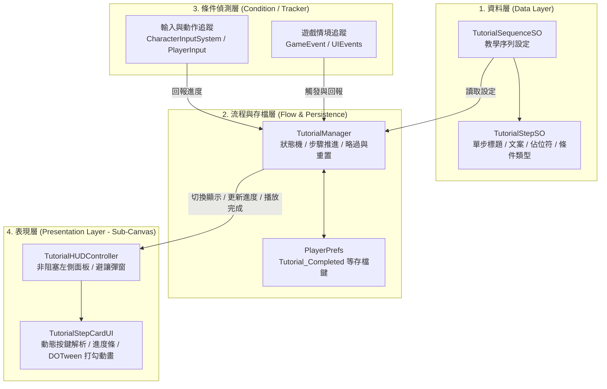

# 互動式新手教學系統（Interactive Tutorial System）架構設計規格書

> **文件狀態**：架構定案草稿（待確認第四章「實作細節決策清單」後進入開發）  
> **專案名稱**：Dungeon (ARPG 地牢冒險)  
> **編寫目的**：規劃打掉舊版彈窗式教學（`TutorialController`），重構為「僅首次遊玩觸發、畫面左側非阻塞提示、玩家完成對應操作即推進」的互動式教學系統框架。

---

## 目錄
1. [重構背景與設計目標](#1-重構背景與設計目標)
2. [系統整體架構（四層分層設計）](#2-系統整體架構四層分層設計)
3. [各層模組規格設計](#3-各層模組規格設計)
   - [3.1 資料層（Data Layer）](#31-資料層data-layer)
   - [3.2 流程與存檔層（Flow & Persistence Layer）](#32-流程與存檔層flow--persistence-layer)
   - [3.3 條件偵測層（Condition / Tracker Layer）](#33-條件偵測層condition--tracker-layer)
   - [3.4 表現層（Presentation Layer）](#34-表現層presentation-layer)
4. [地牢關卡節奏整合建議](#4-地牢關卡節奏整合建議)
5. [現有腳本整合點與異動範圍](#5-現有腳本整合點與異動範圍)
6. [待確認之實作細節決策清單](#6-待確認之實作細節決策清單)

---

## 1. 重構背景與設計目標

### 1.1 舊版系統問題（`Assets/Script/UI/TutorialPanel/TutorialController.cs`）
目前專案中的 `TutorialController` 繼承自 `UIPanelBase`，存在以下體驗與架構限制：
- **強制中斷遊戲**：`PauseGameWhenOpen => true`，開局立即暫停遊戲並由 `UIController` 將 `PlayerInput` 切換為 `UI` ActionMap、解鎖滑鼠游標，玩家只能純看說明圖文按確認關閉。
- **觸發條件過於單純**：僅以 `GameManager.Instance.currentLevel == 1` 判斷，導致玩家每一局進入第 1 層都會重複彈出。
- **缺乏操作反饋**：無法驗證玩家是否真正理解移動、翻滾、攻擊與互動操作。

### 1.2 新版核心目標
1. **首次遊玩限定**：透過 `PlayerPrefs` 持久化完成狀態（對齊 `MetaProgressionManager` 的本地存檔風格），僅在玩家首次遊玩時啟動，並可於設定頁提供重置／重看入口。
2. **左側非阻塞式互動引導（Non-blocking HUD）**：在畫面左側跳出簡潔提示卡，**不暫停時間、不切換 ActionMap、不搶奪滑鼠游標**，讓玩家邊操作邊學習。
3. **動態按鍵顯示**：直接讀取 `InputAction` 當前綁定字串，完全相容 `SettingsController` 的玩家自訂改鍵（Rebind）。
4. **低耦合與資料驅動**：透過 ScriptableObject 定義教學步驟，透過事件匯流排（`GameEvent` / `UIEvents`）與輸入追蹤器判定完成，不將教學邏輯寫死在戰鬥或移動腳本中。

---

## 2. 系統整體架構（四層分層設計）

---

## 3. 各層模組規格設計

### 3.1 資料層（Data Layer）

將每一個教學步驟抽離為 ScriptableObject，方便在 Unity Inspector 中直接增刪、調整順序、微調目標次數與文案。

- **`TutorialSequenceSO`**：
  - 存放有序的 `List<TutorialStepSO>`。
  - 可支援多條序列或分階段群組（例如：基礎移動篇、戰鬥篇、地牢互動篇）。
- **`TutorialStepSO`** 建議欄位：
  - `stepId` (`string`)：唯一識別碼（如 `"move"`, `"roll"`, `"attack"`, `"interact"`）。
  - `title` (`string`)：步驟簡短標題（如 `"基礎移動"`）。
  - `descriptionTemplate` (`string`)：含按鍵佔位符的提示文字（如 `"使用 {Movement} 移動，按住 {Run} 奔跑"`）。
  - `actionKeyBindings` (`List<ActionPlaceholder>`)：定義佔位符與 `InputAction` 路徑的對應（例如 `{LAtk}` → `"Player/LAtk"`），顯示時動態替換為當前綁定按鍵名稱。
  - `triggerMode`（進場時機）：
    - `Immediate`：上一步完成後立即滑入。
    - `OnEnterFightingRoom`：進入第一個 `FightingRoom` 時觸發。
    - `OnInteractableDetected`：首次靠近可互動物件時觸發。
  - `conditionType`（完成判定類型）：枚舉定義（移動、轉視角、奔跑、翻滾、普攻、開啟角色面板、擊殺敵人、與物件互動等）。
  - `targetProgress` (`float` / `int`)：目標門檻（例如：移動累積 `1.2` 秒、攻擊 `2` 次、翻滾 `1` 次）。
  - `isOptional` (`bool`)：是否允許玩家在未完成時被後續情境事件自動推進，避免卡關。

---

### 3.2 流程與存檔層（Flow & Persistence Layer）

由 `TutorialManager` 統一管理教學狀態機與生命週期：

1. **狀態機流轉**：
   - `Inactive`：非首次遊玩（`PlayerPrefs` 已標記完成）或已手動略過。
   - `WaitingForTrigger`：已啟動教學，等待玩家生成或進入對應觸發情境（如等待進入戰鬥房）。
   - `ActiveStep`：左側提示已顯示，持續接收條件進度並更新 UI。
   - `CompletingStep`：達成目標門檻，通知 UI 播放打勾與退場動畫（例如 `0.6s ~ 1.0s`），之後進入下一步或轉為 `WaitingForTrigger`。
   - `Completed`：所有步驟完成，寫入 `PlayerPrefs` 並永久關閉教學。

2. **跨系統邊界處理**：
   - **玩家生成重新綁定**：監聽 `GameEvent.OnPlayerSpawn`，於 `StartRoom` 生成或重建玩家時自動取得新的 `PlayerInput` / `CharacterInputSystem` 參照。
   - **彈窗避讓**：當 `UIController.Instance`（或透過查詢 `UIController.HasOpenPanels`）顯示 `EscController`、`SettingsController` 等全螢幕或中心彈窗時，自動暫停輸入進度偵測並將左側教學 HUD 淡出隱藏；關閉彈窗後恢復。
   - **設定頁整合（選配）**：提供 `TutorialManager.ResetTutorial()` 公開方法，未來可綁定至設定頁的「重置新手教學」按鈕或測試用快捷工具。

---

### 3.3 條件偵測層（Condition / Tracker Layer）

為保持核心遊戲邏輯乾淨，採取「集中偵測＋事件廣播」兩條路徑：

1. **輸入與即時操作類（由教學追蹤器直接讀取 `PlayerInput` / `CharacterInputSystem`）**：
   - **移動 (`Movement`)**：偵測 `playerMovement.sqrMagnitude > 0.01f` 的累積有效秒數（避免誤觸一下就過關）。
   - **轉視角 (`CameraLook`)**：偵測滑鼠／視角輸入累積移動量。
   - **奔跑 (`Run`)**：偵測移動中且 `playerRun` 為真之累積時間。
   - **翻滾 (`RAtk`)**：偵測 `playerRoll` 觸發次數（且建議確認角色非處於無法翻滾的面板開啟狀態）。
   - **普通攻擊 (`LAtk`)**：偵測 `playerLAtk` 觸發次數（或於 `PlayerCombatSystem` 發動攻擊時廣播事件）。
   - **開啟角色面板 (`Character`)**：偵測 `Character` 鍵觸發或 `PlayerStatsController` 開啟。

2. **遊戲情境與互動類（透過 `GameEvent` / `UIEvents` 廣播）**：
   - **進入房間**：直接訂閱現有的 `UIEvents.OnRoomEntered`（傳入 `Room`，可判斷 `room is FightingRoom`、`room is ChestRoom` 等）。
   - **接近可互動物件**：直接訂閱現有的 `UIEvents.OnInteractableDetected`（當字串非空代表準心／範圍內有互動物件）。
   - **完成互動 / 擊殺敵人**（後續實作時建議補充的輕量事件）：
     - 在 `PlayerInteractSystem.OnInteract()` 成功呼叫 `closestInteractable.Interact(transform)` 後廣播互動完成事件。
     - 在敵人死亡或 `GameManager.killCount` 增加時廣播擊殺事件。

---

### 3.4 表現層（Presentation Layer）

1. **獨立於 `UIPanelBase` 之外的 HUD 控制器（`TutorialHUDController`）**
   - **不繼承 `UIPanelBase`**：避免被 `UIController` 納入 `activePanels` 堆疊，從根本杜絕 `Time.timeScale = 0` 與搶奪 `UI` ActionMap 的問題。
   - **Sub-Canvas 動靜分離**：依循專案 `PERFORMANCE_AND_UI_SPECIFICATION.md` 規範，為教學 HUD 配置獨立的 `Canvas`（或 Sub-Canvas），使 DOTween 滑入／打勾／進度條動畫只重建教學面板本身，不波及主 HUD。
   - **RayCast 設為非阻擋**：面板背景與文字取消 `Raycast Target`（除非設有「略過教學」按鈕），確保完全不會擋住玩家滑鼠點擊與視角操作。

2. **視覺與動畫設計（搭配 `DOTween` 與 `GameAssets`）**
   - **版面位置**：錨點固定於畫面左側（Anchor Left-Center 或 Left-Top，需避開小地圖與血條位置）。
   - **動態狀態回饋**：
     - 進場：從左側螢幕外滑入（`DOAnchorPosX`）並淡入（`CanvasGroup.DOFade`）。
     - 進行中：顯示操作提示、高亮按鍵標籤（如 `[WASD]`、`[左鍵]`）、以及即時進度顯示（如 `1 / 2` 或細進度條）。
     - 完成：勾選圖示彈出（`DOScale`）、文字／邊框轉為完成色、播放 `GameAssets` 輕提示音效，停留短暫時間後滑出退場。

---

## 4. 地牢關卡節奏整合建議

配合專案既有的地牢生成流程（`StartRoom` → `FightingRoom` → `ChestRoom / ShopRoom / PortalRoom`），建議採用**三階段情境推進**，讓玩家在合適的當下學對應的操作：

| 階段 | 觸發時機 | 建議教學項目 | 設計目的 |
| :--- | :--- | :--- | :--- |
| **Phase 1：基礎操作** | 進入第 1 層 `StartRoom` 且玩家生成完成 | 1. 移動 (`Movement`) 2. 轉動視角 (`CameraLook`) / 奔跑 (`Run`) 3. 翻滾閃避 (`RAtk`) 4. （選配）開啟角色面板 (`Character`) | 在無敵人壓力的安全區熟悉基本移動與保命動作 |
| **Phase 2：戰鬥入門** | 玩家首次走進任一 `FightingRoom` (`UIEvents.OnRoomEntered`) | 1. 普通攻擊 (`LAtk`) 2. 擊敗房間內的敵人 | 看到怪物時才教攻擊，建立直接的戰鬥正反饋 |
| **Phase 3：地牢互動** | 玩家首次靠近寶箱、掉落物或傳送門 (`UIEvents.OnInteractableDetected`) | 1. 按下互動鍵 (`Interact`) 開啟寶箱／使用傳送門 | 走到物件旁即時提示按鍵，避免開局死記按鍵 |

---

## 5. 現有腳本整合點與異動範圍

| 現有檔案 | 預計處理方式 | 說明 |
| :--- | :--- | :--- |
| `Assets/Script/UI/TutorialPanel/TutorialController.cs` | 淘汰／替換 | 移除進遊戲強彈的 `UIPanelBase` 舊版教學視窗邏輯與對應場景物件 |
| `Assets/Script/GameAssets/UIEvents.cs` / `GameEvent.cs` | 擴充事件（低侵入） | 複用 `OnPlayerSpawn`、`OnRoomEntered`、`OnInteractableDetected`；視需要補充互動完成、擊殺事件 |
| `Assets/Script/Player/PlayerInteractSystem.cs` | 補一行事件廣播 | 於成功執行 `closestInteractable.Interact(transform)` 時發出互動通知 |
| `Assets/Script/UI/UIController.cs` | 唯讀整合 | 透過 `HasOpenPanels` 讓教學 HUD 在 Esc／角色／設定面板開啟時自動淡出避讓 |
| `Assets/Script/UI/Setting/SettingController.cs` | 讀取綁定＋選配重置鈕 | 透過 `InputAction` 讀取即時按鍵文字；可視需求加入「重置新手教學」按鈕 |

---

## 6. 待確認之實作細節決策清單

在撰寫任何程式碼與製作 UI Prefab 前，請先確認以下 5 項設計決策：

| 編號 | 討論項目 | 選項與建議 | 決策結果（待填） |
| :--- | :--- | :--- | :--- |
| **D1** | **要包含的教學操作清單** | 必選：移動、奔跑、翻滾、普攻、互動 可選：轉視角、開啟角色面板 (`C`)、商店購買 | *(待確認)* |
| **D2** | **左側提示呈現模式** | **A. 單步聚焦式**：一次只顯示 1 張提示卡，完成即切換下一張 **B. 任務清單式**：左側一次列出該階段 2~3 個小目標，可不按順序完成並逐條打勾 | *(待確認)* |
| **D3** | **超前操作與跳房容錯** | 若玩家在 Phase 1 還沒做完翻滾就直接跑進戰鬥房： **A. 彈性推進**（直接切換至 Phase 2 戰鬥教學，或於背景保留/標記完成） **B. 嚴格鎖門**（完成基礎操作才開門，不推薦用於動作遊戲） | *(待確認)* |
| **D4** | **略過與重玩機制** | 1. 是否在左側教學框旁提供「略過教學」操作（例如長按某鍵或小按鈕）？ 2. 是否需要在設定頁加入「重置新手教學」按鈕，及在 Inspector 加入測試用「強制重播教學」勾選框？ | *(待確認)* |
| **D5** | **左側 HUD 精確擺放位置** | 需確認目前 `GameScene` 主 HUD 畫面左側（左上、左中、左下）已有哪些 UI（如玩家血條、小地圖、金幣顯示），以決定教學卡的 Anchor 與 Y 軸座標。 | *(待確認)* |
