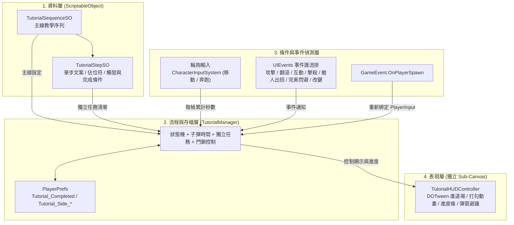

# 互動式新手教學系統（Interactive Tutorial System）架構與維護規格書

> **文件狀態**：實作完成（已整合至 `GameScene.unity`，支援主線教學、子彈時間閃避與獨立情境任務）  
> **專案名稱**：Dungeon (ARPG 地牢冒險)  
> **文件目的**：記錄新版非阻塞互動式新手教學系統之最終架構、腳本職責、觸發原理與後續擴充指南。

---

## 1. 系統設計目標與特色

相較於舊版 `TutorialController`（繼承 `UIPanelBase`、開局強制暫停並切換為 `UI` ActionMap），新版系統具備以下特性：
1. **非阻塞式無底板浮動 HUD**：不暫停遊戲、不切換 `PlayerInput` ActionMap、不搶奪滑鼠游標；UI 固定於畫面左側約七成高度（`anchor = (0, 0.7)`），採用無背景底板的極簡單行指令搭配專用 TMP 描邊陰影材質，兼顧清晰度與畫面視野。
2. **首次遊玩持久化與獨立情境任務**：
   - **主線序列**（`Tutorial_Completed`）：記錄 1～6 步主線教學是否完成。
   - **獨立任務**（`Tutorial_Side_{stepId}_Completed`）：針對 `ShopRoom` 等分支房間事件提供獨立存檔，不受主線是否結束影響。
3. **動態按鍵顯示**：直接讀取 `PlayerInput.actions` 當前綁定字串，相容 `SettingsController` 改鍵（`UIEvents.OnBindingsChanged` 即時刷新）。
4. **戰鬥子彈時間閃避教學**：進入戰鬥房後，偵測近距離敵人出招延遲 `0.1s` 切入 `0.08x` 慢動作，引導玩家使用右鍵閃避，按下後立即恢復 `1.0x` 時間銜接無敵幀。
5. **防呆與容錯機制**：前三步完成前暫時將 `StartRoom` 門碰撞體切為 `UnInteractable`；開啟 `Esc`／設定／角色面板時自動淡出避讓；支援長按 `Tab`（`0.8s`）略過及設定頁「重置新手教學」。

---

## 2. 系統四層架構

---

## 3. 核心腳本與資產清單

### 3.1 新增核心腳本
| 檔案 | 職責說明 |
| :--- | :--- |
| `Assets/Script/DataSO/TutorialStepSO.cs` | 定義單一步驟資料：`stepId`、`descriptionTemplate`、`actionBindings`、`TutorialTriggerMode`（`Immediate` / `OnEnterFightingRoom` / `OnInteractableDetected` / `OnEnemyAttackInCombat` / `OnEnterShopRoom`）、`TutorialConditionType`、`targetProgress`、`isDurationCondition`、`allowElasticAdvance` |
| `Assets/Script/DataSO/TutorialSequenceSO.cs` | 存放有序的 `List<TutorialStepSO>`，提供 `GetStep()` 與 `FindNextStepIndexByTrigger()` |
| `Assets/Script/UI/TutorialPanel/TutorialManager.cs` | 教學總管：狀態機（`Inactive` / `WaitingForTrigger` / `ActiveStep` / `CompletingStep` / `Completed`）、動態按鍵解析、子彈時間控制、獨立任務管理、`StartRoom` 門鎖切換、`PlayerPrefs` 存取與長按 `Tab` 略過 |
| `Assets/Script/UI/TutorialPanel/TutorialHUDController.cs` | 非阻塞式表現層（獨立 Sub-Canvas）：DOTween 滑入／打勾／退場、`SetUpdate(true)` 彈窗避讓淡出、長按略過進度條 |
| `Assets/Editor/TutorialSystemSetupTool.cs` | Editor 一鍵建置工具（選單 `Dungeon -> Tutorial -> 一鍵建置互動式新手教學系統`）：生成程序化 Sprite、TMP 陰影材質、預設 6 步驟 SO、`TutorialHUD.prefab` 與 `GameScene` 設定頁重置按鈕 |

### 3.2 現有系統整合點
| 檔案 | 整合內容 |
| :--- | :--- |
| `Assets/Script/GameAssets/UIEvents.cs` | 新增事件：`OnInteractCompleted`、`OnEnemyKilled`、`OnBindingsChanged`、`OnPlayerAttacked`、`OnPlayerRolled`、`OnEnemyAttackStarted`、`OnPlayerPerfectDodge` |
| `Assets/Script/Player/PlayerCombatSystem.cs` | 執行攻擊時廣播 `UIEvents.PlayerAttacked()` |
| `Assets/Script/Player/PlayerMovementSystem.cs` | 觸發翻滾時廣播 `UIEvents.PlayerRolled()` |
| `Assets/Script/Player/PlayerInteractSystem.cs` | 成功互動後廣播 `UIEvents.InteractCompleted(closestInteractable)` |
| `Assets/Script/Player/PlayerHealthSystem.cs` | 無敵幀閃避成功時廣播 `UIEvents.PlayerPerfectDodge()` |
| `Assets/Script/Abstract/FightingRoom.cs` | 公開 `IsClear` 並於 `OnEnemyDeath()` 廣播 `UIEvents.EnemyKilled()` |
| `Assets/Script/Ability/AbilityBase.cs` & `CharacterCombatBase.cs` | 敵人發動技能／開啟 Hitbox 時廣播 `UIEvents.EnemyAttackStarted(attacker)` |
| `Assets/Script/UI/Setting/SettingController.cs` | 改鍵完成後廣播 `UIEvents.BindingsChanged()`；新增 `ResetTutorial()` 綁定設定頁「重置新手教學」按鈕 |
| `Assets/Script/UI/TutorialPanel/TutorialController.cs` | 標記為 `[Obsolete]` 並停用 `PauseGameWhenOpen` 與開局彈窗 |

### 3.3 生成資產與 Prefab
- **UI Prefab**：`Assets/Prefab/TutorialHUD.prefab`（掛載於 `GameScene.unity` 主 `Canvas` 下）
- **UI 素材**：`Assets/SpritesUI/Tutorial/`（`tutorial_check_badge.png`、`tutorial_check_mark.png`、`tutorial_progress_track.png`、`tutorial_progress_fill.png`、`SourceHanSerifTW_TutorialShadow.mat`）
- **主線步驟資產**：`Assets/ScriptableObjects/Tutorial/`（`Step_01_Move` ~ `Step_06_Dodge` 與 `TutorialSequence_Default.asset`）

---

## 4. 主線教學流程與特殊機制

### 4.1 主線 6 步驟順序
1. **`Step_01_Move`**：按 `[WASD]` 移動（`Immediate`，累積 `1.2s`）
2. **`Step_02_Run`**：移動時按住 `[Shift]` 奔跑（`Immediate`，累積 `0.8s`）
3. **`Step_03_Attack`**：按 `[滑鼠左鍵]` 普通攻擊（`Immediate`，`2` 次）
4. **`Step_04_Interact`**：靠近門或寶箱按 `[E]` 互動（`OnInteractableDetected`，`1` 次，`allowElasticAdvance = true`）
5. **`Step_05_Kill`**：擊敗房間內的敵人（`OnEnterFightingRoom`，`1` 名）
6. **`Step_06_Dodge`**：敵人攻擊！按 `[滑鼠右鍵]` 閃避（`OnEnemyAttackInCombat`，`1` 次）

### 4.2 關鍵機制說明
- **`StartRoom` 門鎖機制**：在完成前 3 步（進入 `InteractCount` 步驟）之前，`TutorialManager` 會快取 `StartRoom` 門下互動碰撞體的原始圖層並切換為 `UnInteractable`；進入第 4 步（或略過／非首次遊玩）時還原圖層。
- **戰鬥閃避子彈時間**：進入 `FightingRoom` 後先顯示 `Step_05_Kill`；當 `4.5m` 內敵人出招並經過 `0.1s`（`dodgeBulletTimeDelay`），切換至 `Time.timeScale = 0.08f`（同步調整 `Time.fixedDeltaTime`），插隊顯示 `Step_06_Dodge`。玩家按下閃避或觸發完美閃避立即恢復 `Time.timeScale = 1f`，並設有 `4.0s` 真實時間超時防卡死。
- **獨立情境任務（`independentSteps`）**：用於商店（`ShopRoom`）等分支房間事件。每筆獨立任務以 `Tutorial_Side_{stepId}_Completed` 各自存檔；若玩家離開商店並進入 `FightingRoom`（且勾選 `allowElasticAdvance`），會自動收起提示。

---

## 5. 如何新增教學內容

### 情況 A：使用現有條件類型（僅需 Unity Inspector）
1. 在 `Assets/ScriptableObjects/Tutorial/` 右鍵 **`Create -> Dungeon -> Tutorial -> Tutorial Step`** 建立新資產。
2. 填寫 `stepId`、單行 `descriptionTemplate`（建議 12～16 字內）、`actionBindings`、`triggerMode` 與 `conditionType`。
3. 若屬於**主線步驟**，拖入 `TutorialSequence_Default.asset`；若屬於**獨立情境任務**，拖入 `GameScene` 中 `TutorialHUD` 上 `TutorialManager` 的 **`Independent Steps`** 清單。

### 情況 B：需要全新事件或條件類型
1. 在 `TutorialStepSO.cs` 擴充 `TutorialTriggerMode` 或 `TutorialConditionType`。
2. 在 `UIEvents.cs` 新增對應靜態事件，並於遊戲邏輯處（如商店購買、房間進入等）呼叫廣播。
3. 在 `TutorialManager.cs` 訂閱事件，於 `TryTriggerIndependentStep()` / `TryActivateCurrentStepIfReady()` 或進度回調中接上判定即可。

---

## 6. 測試與除錯
- **Inspector 強制重播**：選取 `GameScene` 的 `Canvas/TutorialHUD`，勾選 `TutorialManager` 的 **`Force Replay On Start`**。
- **Inspector 右鍵選單**：在 `TutorialManager` 元件右上角 `⋮` 點選 **`重置新手教學存檔`** 或 **`立即強制重播教學`**。
- **遊戲內重置**：按 `Esc` → **設定 → 偏好設定 → 點擊「重置新手教學」**。
