# 🏰 地牢遊戲數值系統完整規格手冊 (Numerical System Specification)

> **文件目的與交接說明**：  
> 本文件旨在為後續負責數值調優、戰鬥驗證、系統分析之開發者／AI 助理提供完整、自洽且已深入代碼驗證的數值規格手冊。  
> 本規格建立於遊戲底層架構（`CharacterStats` 中央大腦、`StatModifier` 修正器）、關卡生成實況（低怪物密度 1v1/1v2 精英對決）、戰鬥機制（無戰鬥回血、招式獨立 CD）與怪物四階生態之上。

---

## 目錄
1. [底層戰鬥運算與核心公式](#1-底層戰鬥運算與核心公式)
2. [關鍵戰鬥情境與機制限制](#2-關鍵戰鬥情境與機制限制)
3. [角色基礎屬性與開局閉環規格](#3-角色基礎屬性與開局閉環規格)
4. [四階怪物生態體系與平衡規格](#4-四階怪物生態體系與平衡規格)
5. [武器系統與連段動作模組規格](#5-武器系統與連段動作模組規格)
6. [防具裝備系統規格（騎士套 vs 聖騎士套）](#6-防具裝備系統規格騎士套-vs-聖騎士套)
7. [角色局外養成升級系統（Meta-Progression）](#7-角色局外養成升級系統meta-progression)
8. [補給品與經濟循環規格](#8-補給品與經濟循環規格)
9. [專案資產檔案對應清單（交接修改指引）](#9-專案資產檔案對應清單交接修改指引)

---

## 1. 底層戰鬥運算與核心公式

### 1.1 屬性管理器階層計算（`CharacterStat.CalculateFinalValue`）
所有角色與怪物屬性均封裝於 `CharacterStat` 容器內，支援 Dirty Flag 機制，計算公式為：
$$\text{最終屬性值} = (\text{BaseValue} + \sum \text{Flat}) \times (1 + \sum \text{PercentAdd}) \times \prod (1 + \text{PercentMult})$$
* **Flat（優先級 100）**：裝備基本加值、武器基底傷害、局外升級固定增量。
* **PercentAdd（優先級 200）**：天賦累加、常規 Buff。
* **PercentMult（優先級 300）**：獨立乘算狀態（如狂暴狀態 1.2x）。

### 1.2 傷害計算（`CharacterCombatBase`）
當前武器之 `damage` 作為 Flat 修正器直接註入 `CharacterStats.AttackDamage`：
$$\text{RawDamage} = \text{AttackDamage} \times \text{AttackData.damageMultiplier}$$
* **暴擊判定**：`Random.value < (CritRate / 100f)`
* **暴擊傷害**：固定為 **$1.5\times$（150% 傷害）**：
$$\text{FinalRawDamage} = \begin{cases} \text{RawDamage} \times 1.5 & (\text{暴擊}) \\ \text{RawDamage} & (\text{未暴擊}) \end{cases}$$

### 1.3 護甲非線性減傷雙曲線（`PlayerHealthSystem` & `EnemyHealthSystem`）
遊戲採用經典雙曲線減傷模型：
$$DR = \frac{\text{Shield}}{\text{Shield} + 100}$$
$$\text{實際減傷率 } DR = \text{Clamp}(DR, 0, 0.85) \quad (\text{減傷上限 } 85\%)$$
$$\text{最終實受傷害} = \text{RoundToInt}(\text{FinalRawDamage} \times (1 - DR))$$

* **護甲收益參考對照**：
  * **$0$ 護甲**：$0\%$ 減傷
  * **$26.5$ 護甲（戰士開局）**：$\frac{26.5}{126.5} \approx 20.95\%$ 減傷
  * **$50$ 護甲**：$\frac{50}{150} \approx 33.33\%$ 減傷
  * **$100$ 護甲**：$\frac{100}{200} = 50.0\%$ 減傷
  * **$200$ 護甲**：$\frac{200}{300} \approx 66.67\%$ 減傷

### 1.4 韌性與受擊硬直機制（`Poise System`）
* **受擊門檻**：受到的單次傷害必須大於目標最大生命的 **$5\%$**（`finalDamage / MaxHealth > 0.05`），否則視為輕微碰撞，不扣韌性也不打斷出招。
* **削韌**：滿足門檻後扣除該招式之 `AttackData.poiseDamage`。
* **破韌（Stagger）**：`currentPoise <= 0` 時觸發受擊動畫（CrossFade `hitAnimationName`），打斷當前出招、重置攻擊連段，隨後重置韌性條至上限。
* **韌性自動恢復**：停手不受擊 **$3$ 秒**（`poiseRecoveryDelay`）後，以每秒 **$20$ 點**（`poiseRecoveryRate`）快速回滿。

---

## 2. 關鍵戰鬥情境與機制限制

在進行數值分析或修改時，必須嚴格遵守以下由專案源代碼決定的核心遊戲機制：

```mermaid
flowchart TD
    subgraph 關卡與生成情境
        G[Generator 關卡生成] -->|關卡共4層 1-1 ~ 1-4| R[房間數 = Level + 1]
        R -->|Level 1: 僅1間戰鬥房<br>整關僅4隻小怪| B[戰鬥形式: 1v1 / 1v2 精英對決]
    end

    subgraph 技能AI決策機制
        SM[StateMachineSystem] -->|獨立冷卻倒數| AP[Ability Pool 技能庫]
        AP -->|距離符合 0~2.5m 等| CS[候選技能]
        CS -->|Weight 加權隨機抽取| EX[釋放技能]
        EX -->|觸發技能獨立CD 10~30s| SM
        EX -->|EnsureMinSkillCooldown| CD1[全技能保底間隔 1s]
        CD1 -->|實戰多招交替| GAP[實際進攻空窗僅 3~4s]
    end

    subgraph 資源與生存限制
        DMG[戰鬥中扣血] --> NO_HEAL[戰鬥中完全無法喝水補血]
        NO_HEAL --> ATTRITION[血量為關卡累積消耗品<br>受擊懲罰極重]
        SHOP[非戰鬥時商店房] -->|花費金幣購買血瓶| INSTANT[立即強制使用回復]
    end
```

### 2.1 怪物招式獨立冷卻（Multi-Skill Independent CD）
* 怪物擁有 **多技能庫**（如 Orc 擁有 6 個招式，骷髏戰士擁有 4 個招式）。
* **每個招式獨立計時 CD**：大招（如連招 Combo、巨力下砸）冷卻 20~30 秒，常規招式（如橫掃、左斬）冷卻 10~15 秒。
* 因多招式交替施放，在目標處於攻擊範圍內時，**怪物實際的出招空窗期僅為 3 ~ 4 秒**。因此強技能長 CD 的設計是合理的，切勿盲目縮減 CD。

### 2.2 戰鬥中無法回血（No In-Combat Healing）
* 遊戲無快捷喝水按鈕，無吸血天賦。
* 唯一回血途徑：非戰鬥時在商店房以金幣購買血瓶（`ShopPotion`），且**購買後立即使用**。
* **數值導向**：生命值是整層地牢探索的「累積磨損資源」，受擊代價極高。不可隨意削弱玩家開局血量（戰士開局 177 HP 屬於健康的探索資本）。

### 2.3 地牢低怪量與精英對決實況
* 遊戲並非割草無雙遊戲。第 1 關全圖僅 1 間戰鬥房（共 4 隻小怪，分 2 波每波 2 隻）；第 2~3 關每房僅 3~4 隻怪，甚至常常出現「單獨 1 隻獸人」或「2 隻骷髏」的配置。
* **戰鬥定位**：高專注度的 1v1 或 1v2 戰術遭遇戰，每隻怪物的戰鬥表現必須精銳、有威脅感。

### 2.4 廢案排除清單
* `Assets/Prefab/Character/Legacy/Boss.prefab` 及 `Assets/ScriptableObject/AttackData/Boss/*` 為 Legacy 廢案，完全排除不計。
* 遊戲唯一正牌 Boss 為 **深淵石巨人（Golem）**，配置於 `Enemy_StoneGiantBoss.asset`、`Golem.prefab` 及 `Ability/Golem`。

---

## 3. 角色基礎屬性與開局閉環規格

戰士（Fighter / CharacterID = 0）採用「底模 + 初始裝備自動穿戴」的嚴密閉環架構：

| 屬性項目 | 裸體底模 (`Character_Warrior.asset`) | 初始裝備 (初級騎士6件套) | 進入遊戲戰士總面板 | 設計目的與驗證 |
| :--- | :--- | :--- | :--- | :--- |
| **生命上限 (MaxHealth)** | **100** | **+77** | **177** | 面對無回血累積磨損的健康資本 |
| **護甲防禦 (Shield)** | **0** | **+26.5** | **26.5** (實質減傷 $20.95\%$) | 提供基礎約兩成減傷，降低小怪摸血懲罰 |
| **基礎攻擊 (Attack)** | **10** (空手基底) | **+8** (護手) | **18** (+ 主武器傷害) | 配合新手單手劍 (10 傷) 達 28 總攻 |
| **暴擊率 (CritRate)** | **5%** | **+3%** (護手) | **8%** | 保持輕度驚喜暴擊回饋 |
| **移動速度 (MoveSpeed)** | **5.0** | - | **走 3.0 / 跑 7.0** | 依武器規格動態覆蓋 |
| **韌性上限 (Poise)** | **100** | - | **100** | 可承受 3~4 次小怪攻擊不被中斷動作 |

---

## 4. 四階怪物生態體系與平衡規格

### 4.1 四階生態架構
* **Tier 1 (全期基礎小怪)**：`SkeletonMinion`（小骷髏）
* **Tier 2 (中期主力怪，第 2 關登場)**：`SkeletonArcher`（骷髏弓箭手）+ `SkeletonWarrior`（骷髏戰士）
* **Tier 3 (後期強敵，第 3、4 階段登場)**：`Orc`（獸人蠻卒）+ `Mage`（死靈法師）
* **Tier 4 (最終頂級 Boss，第 4 關關底)**：`Golem`（深淵石巨人）

### 4.2 怪物基礎數值規格表（Level 1 基準）

| 怪物名稱 | 階級 | 基礎 HP | 基礎傷害 | 護甲 (減傷) | 韌性 | 跑速 | 掉落金幣 | 玩家實受傷害 (平砍 / 大招) | 擊殺刀數 (TTK) | 實戰定位與威脅說明 |
| :--- | :--- | :--- | :--- | :--- | :--- | :--- | :--- | :--- | :--- | :--- |
| **小骷髏** (Minion) | T1 (全期) | **38** | **10** | 0 ($0\%$) | 30 | 3.8 | 2 金 | 實扣 **8** 點血 | 2 刀擊殺 | 全期砲灰；受擊扣 8 血有微痛感，累積損耗有感 |
| **骷髏弓箭手** (Archer) | T2 (中期) | **65** | **15** | 0 ($0\%$) | 45 | 3.0 | 6 金 | 實扣 **12** 點血 | 3 刀擊殺 | 中遠程冷箭；3 秒一發，具備後跳迴避拉扯 |
| **骷髏戰士** (Warrior) | T2 (中期) | **110** | **16** | 0 ($0\%$) | 80 | 3.2 | 5 金 | 平砍 **13** / 三連斬 **40+** | 4 刀 (近一套) | **中期核心劍客！** 左右斬交替，三連斬威脅極高 |
| **死靈法師** (Mage) | T3 (後期) | **95** | **22** | 2 ($2\%$) | 60 | 3.2 | 10 金 | 死靈彈實扣 **17** 點血 | 3~4 刀 | 遠程高傷術士，近身瞬移拉扯，召喚小骷髏 |
| **獸人蠻卒** (Orc) | T3 (後期) | **220** | **24** | 5 ($5\%$) | **130** | 3.0 | 8 金 | 平砍 **19** / 巨砸與連擊 **35~50** | 8~10 刀 (2套) | **單體重裝巨漢！** 血厚防高，重砸削掉 1/4 血 |
| **深淵石巨人** (Golem) | T4 (Boss) | **650** | **30** | 15 ($13\%$) | **250** | 2.8 | 60 金 | 右拳 **18** / 踩踏 **26** / **大跳 52** | 25~30 刀 | **關底守關 Boss！** 縮放後破千血，壓迫感充足 |

### 4.3 關卡動態縮放係數與菁英倍率
敵人於第 $N$ 關生成時，屬性計算公式為：
$$\text{HP} = \text{BaseHP} \times [1 + (N - 1) \times \text{healthGrowthPerLevel}] \times (\text{isElite ? eliteHealthMult : 1})$$
$$\text{Damage} = \text{BaseDamage} \times [1 + (N - 1) \times \text{damageGrowthPerLevel}] \times (\text{isElite ? eliteDamageMult : 1})$$
$$\text{Gold} = \text{BaseGold} \times [1 + (N - 1) \times \text{goldGrowthPerLevel}] \times (\text{isElite ? eliteGoldMult : 1})$$

| 怪物種類 | 每關生命成長 | 每關傷害成長 | 每關金幣成長 | 菁英生命倍率 | 菁英傷害倍率 | 菁英金幣倍率 | 菁英體積縮放 |
| :--- | :--- | :--- | :--- | :--- | :--- | :--- | :--- |
| **小骷髏** | +15% /關 | +8% /關 | +10% /關 | 1.6x | 1.25x | 2.0x | 1.20x |
| **骷髏弓箭手** | +12% /關 | +10% /關 | +10% /關 | 1.8x | 1.40x | 3.0x | 1.20x |
| **骷髏戰士** | +15% /關 | +8% /關 | +10% /關 | 2.0x | 1.30x | 3.0x | 1.25x |
| **死靈法師** | +14% /關 | +12% /關 | +10% /關 | 2.0x | 1.35x | 3.0x | 1.25x |
| **獸人蠻卒** | +15% /關 | +10% /關 | +10% /關 | 2.2x | 1.40x | 3.0x | 1.30x |
| **深淵石巨人 (Boss)**| **+25% /關** | **+15% /關** | **+10% /關** | 2.2x | 1.35x | 3.0x | 1.25x |

### 4.4 怪物招式池配置與冷卻規格（Inspector 實測對應）

* **小骷髏 (SkeletonMinion)**：
  * `SkeletonAttack.asset`：CD 5.0s，距離 0 ~ 1.5m，Weight 1，Trigger `Attack3`。
* **骷髏弓箭手 (SkeletonArcher)**：
  * `Shoot.asset`：CD 3.0s，距離 1 ~ 17m，Weight 1，Trigger `Shoot`。
  * `DodgeBack.asset`：CD 7.0s，距離 0 ~ 3m，Weight 10（近身極高優先級後跳），Trigger `Dodge`。
  * `Punch.asset`：CD 10.0s，距離 0 ~ 2m，Weight 1，Trigger `Punch`。
* **骷髏戰士 (SkeletonWarrior)**：
  * `RightSlash.asset`：CD 10.0s，距離 0 ~ 1.5m，Weight 1，Trigger `RightSlash`。
  * `LeftSlash.asset`：CD 15.0s，距離 0 ~ 1.5m，Weight 1，Trigger `LeftSlash`。
  * `360.asset`：CD 15.0s，距離 0 ~ 3.0m，Weight 1，Trigger `360`。
  * `Combo.asset`：CD 25.0s，距離 0 ~ 6.0m，Weight 1，Trigger `Combo`（核心大招三連斬）。
* **獸人蠻卒 (Orc)**：
  * `Horizontal.asset`（橫掃）：CD 15.0s，距離 0 ~ 1.5m，Weight 1，Trigger `Horizontal Attack`。
  * `Downward.asset`（下劈）：CD 20.0s，距離 0 ~ 1.5m，Weight 1，Trigger `Downward`。
  * `Backhand.asset`（上挑）：CD 20.0s，距離 0 ~ 2.5m，Weight 1，Trigger `Backhand`。
  * `360.asset`（旋風斬）：CD 15.0s，距離 0 ~ 2.5m，Weight 1，Trigger `360`。
  * `Kick.asset`（踢腳）：CD 30.0s，距離 0 ~ 1.2m，Weight 2，Trigger `Kick`。
  * `Combo.asset`（瘋狂連擊）：CD 30.0s，距離 0 ~ 4.0m，Weight 1，Trigger `Combo`。
* **死靈法師 (Mage)**：
  * `Projectile.asset`：遠程死靈追蹤彈射擊。
  * `Teleport.asset`：CD 20.0s，距離 0 ~ 3.0m，Weight 10（近身極高優先級瞬移拉開），Trigger `Teleport`。
  * `SpawnMinion.asset`：召喚小骷髏輔助。
* **深淵石巨人 (Golem)**：
  * `RightAttack.asset`（右拳）：CD 8.0s，距離 0 ~ 2.5m，Weight 1，Trigger `RightAttack`。
  * `LeftAttack.asset`（左拳）：CD 15.0s，距離 0 ~ 2.5m，Weight 1，Trigger `LeftAttack`。
  * `Stamp.asset`（踩踏）：CD 15.0s，距離 0 ~ 3.0m，Weight 1，Trigger `Stamp`。
  * `JumpAttack.asset`（大地甦醒躍擊）：CD 15.0s，距離 5 ~ 8.0m，Weight 1，Trigger `JumpAttack`。

---

## 5. 武器系統與連段動作模組規格

### 5.1 武器屬性一覽表

| 武器名稱 | Prefab 檔案 | 類型 (Type) | 武器傷害 | 奔跑速度 | 行走速度 | 攻擊半徑 | 武器特色定位 |
| :--- | :--- | :--- | :--- | :--- | :--- | :--- | :--- |
| **劍 (Sword)** | Sword.prefab | 0 (單手劍) | **10** | 7.0 | 3.0 | 0.55m | 初始標準單手劍，節奏平衡穩定 |
| **英雄劍 (RoyalSword)** | RoyalSword.prefab | 0 (單手劍) | **30** | 7.0 | 3.0 | 0.70m | 廣域打擊單手劍，範圍壓制 |
| **破曉 (Daybreak)** | Daybreak.prefab | 0 (單手劍) | **30** | **10.0** | **5.0** | 0.55m | 極高機動性，游擊拉扯神兵 |
| **噬星者 (StarEater)** | StarEater.prefab | 0 (單手劍) | **30** | 7.0 | 3.0 | 0.55m | 高階平衡單手劍 |
| **太刀 (Katana)** | Katana.prefab | 1 (太刀) | **20** | **10.0** | 4.0 | 0.60m | 極速連斬、超快後搖、高暴擊傾向 |
| **斧頭 (Axe)** | Axe.prefab | 2 (重型/雙手) | **20** | 6.0 | 3.0 | 0.50m | 雙手重兵過渡裝，高削韌打斷 |
| **巨劍 (GreatSword)** | GreatSword.prefab | 2 (重型/雙手) | **35** | 5.0 | 3.0 | 0.70m | 經典大劍，廣域重劈砍 |
| **泰坦之牙 (TitansTooth)** | TitansTooth.prefab| 2 (重型/雙手) | **40** | 5.0 | 3.0 | 0.70m | 高威能重兵，擊破高韌性目標 |
| **岩峰 (Crag)** | Crag.prefab | 2 (重型/雙手) | **50** | **4.0** | **2.0** | **0.75m** | 全武器單發最高傷與最大半徑，移速慢 |
| **手槍 (Gun)** | Gun.prefab | 遠程 | **10** | 7.0 | 3.0 | 投射物 | 遠程安全拉扯 |

### 5.2 武器派系連段倍率與削韌數值（`AttackData`）

* **單手劍系（5 段連擊）**：
  * 段 1: 傷害 **1.0x** / 削韌 **25** / 頓幀 0.05s / 震動力 1.3
  * 段 2: 傷害 **1.0x** / 削韌 **25** / 頓幀 0.05s / 震動力 1.3
  * 段 3: 傷害 **1.2x** / 削韌 **35** / 頓幀 0.05s / 震動力 1.3
  * 段 4: 傷害 **1.3x** / 削韌 **25** / 頓幀 0.05s / 震動力 1.3
  * 段 5: 傷害 **1.1x** / 削韌 **40** / 頓幀 0.05s / 震動力 1.3
  * *整套全中累計倍率：**$5.6\times$** 總攻擊力；累計削韌 **150** 點（能直接擊暈多數非 Boss 怪物）。*
* **太刀系（4~5 段迅捷居合斬）**：
  * 段 1 ~ 4: 各段傷害倍率均為 **1.0x**，削韌值均為 **25**，頓幀僅 **0.03s**，震屏 1.0（手感極其輕快俐落）。
* **雙手重武器系（3 段蓄力重擊）**：
  * 段 1: 傷害 **1.0x** / 削韌 **50** / 頓幀 0.09s / 震屏 1.5
  * 段 2: 傷害 **1.1x** / 削韌 **50** / 頓幀 0.09s / 震屏 1.5
  * 段 3 (重砸): 傷害 **1.5x** / 削韌 **75** / 頓幀 0.09s / 震屏 2.0
  * *特色：單段削韌極高（50~75），極易在 1~2 擊內直接打斷怪物出招並破韌。*

---

## 6. 防具裝備系統規格（騎士套 vs 聖騎士套）

裝備分為 6 部位：**護手 (Arm)、腰帶 (Belt)、胸甲 (Chest)、護靴 (Feet)、頭盔 (Head)、護腿 (Leg)**。

### 6.1 騎士套裝 (Knight Set，攻守兼備)
* **初級騎士套裝 (開局自動穿戴)**：
  * 護手: 攻擊 +8, 護甲 +2.5, 生命 +6, 暴擊 +3%, 售價 5 金
  * 腰帶: 護甲 +3.5, 生命 +10, 售價 7 金
  * 胸甲: 護甲 +8.0, 生命 +25, 售價 15 金
  * 護靴: 護甲 +2.5, 生命 +6, 售價 5 金
  * 頭盔: 護甲 +4.5, 生命 +12, 售價 10 金
  * 護腿: 護甲 +5.5, 生命 +18, 售價 12 金
  * **【初級全套總計】**：生命 **+77**、護甲 **+26.5**（$20.95\%$ 減傷）、攻擊 **+8**、暴擊 **+3%**（總價 54 金）
* **中級騎士套裝 (中期目標)**：
  * 護手: 攻擊 +15, 護甲 +3.5, 生命 +9, 暴擊 +12%, 售價 12 金
  * 腰帶: 護甲 +5.0, 生命 +16, 售價 15 金
  * 胸甲: 護甲 +15.0, 生命 +45, 售價 40 金
  * 護靴: 護甲 +3.5, 生命 +9, 售價 10 金
  * 頭盔: 護甲 +7.0, 生命 +20, 售價 25 金
  * 護腿: 護甲 +8.5, 生命 +30, 售價 30 金
  * **【中級全套總計】**：生命 **+129**、護甲 **+42.5**（$29.82\%$ 減傷）、攻擊 **+15**、暴擊 **+12%**（總價 132 金）
* **高級騎士套裝 (後期神裝)**：
  * 護手: 攻擊 +45, 護甲 +10.0, 生命 +20, 暴擊 +30%, 售價 30 金
  * 腰帶: 攻擊 +10, 護甲 +12.0, 生命 +40, 暴擊 +6%, 售價 35 金
  * 胸甲: 護甲 +40.0, 生命 +120, 暴擊 +6%, 售價 80 金
  * 護靴: 攻擊 +10, 護甲 +8.0, 生命 +20, 暴擊 +6%, 售價 16 金
  * 頭盔: 護甲 +18.0, 生命 +45, 暴擊 +6%, 售價 45 金
  * 護腿: 護甲 +20.0, 生命 +70, 暴擊 +6%, 售價 55 金
  * **【高級全套總計】**：生命 **+315**、護甲 **+108.0**（**$51.92\%$ 減傷**）、攻擊 **+65**、暴擊 **+60%**（總價 261 金）

### 6.2 聖騎士套裝 (SaintKnight Set，高容錯防禦特化)
針對不想因戰鬥無法回血而暴斃的玩家，提供極端生存保障：
* **初級聖騎士套裝**：
  * 全套累計：生命 **+110**、護甲 **+36.0**（$26.47\%$ 減傷）、攻擊 **+3**（總價 65 金）
* **中級聖騎士套裝**：
  * 全套累計：生命 **+200**、護甲 **+65.0**（$39.39\%$ 減傷）、攻擊 **+6**（總價 150 金）
* **高級聖騎士套裝**：
  * 全套累計：生命 **+400**、護甲 **+120.0**（**$54.55\%$ 減傷**）、攻擊 **+15**（總價 320 金）

---

## 7. 角色局外養成升級系統（Meta-Progression）

* **系統定位**：消耗通關/闖關結算帶回的「靈魂貨幣」，永久強化三圍。
* **等級上限**：最高 **10 級**（Lv.0 $\to$ Lv.10）。
* **消耗曲線**：
  $$\text{Cost}(\text{Level}) = 50 + \text{Level} \times 35$$
  * Lv.0 $\to$ 1: 50 | Lv.1 $\to$ 2: 85 | Lv.2 $\to$ 3: 120 | Lv.3 $\to$ 4: 155 | Lv.4 $\to$ 5: 190
  * Lv.5 $\to$ 6: 225 | Lv.6 $\to$ 7: 260 | Lv.7 $\to$ 8: 295 | Lv.8 $\to$ 9: 330 | Lv.9 $\to$ 10: 365
  * **滿級總消耗**：**2,075 靈魂**。
* **每級三圍同步加成**：
  * 生命上限 (HP)：每級 **$+15$**（滿級累計 **$+150$**）
  * 護甲防禦 (DEF)：每級 **$+3$**（滿級累計 **$+30$**）
  * 基礎攻擊 (ATK)：每級 **$+4$**（滿級累計 **$+40$**）

---

## 8. 補給品與經濟循環規格

* **普通治療藥水 (`Potion_Red.prefab`)**：立即回復 **50 生命**，售價 **15 金幣**。
* **強效治療藥水 (`potion.prefab`)**：立即回復 **70 生命**，售價 **25 金幣**。
* **經濟閉環模型**：
  * 第 1 關全圖掉落約 15~20 金幣；第 2 關約 25~35 金幣；第 3 關約 35~50 金幣。
  * 每闖過 1 個關卡，積累的金幣剛好足夠購買 **1 瓶治療藥水** 或 **更新 1 件中級防具**，在「血量容錯補給」與「投資換裝防禦」之間形成關鍵的策略取捨。

---

## 9. 專案資產檔案對應清單（交接修改指引）

後續接手人員／AI 欲修改或對齊特定數值時，直接對照以下專案檔案路徑：

### 9.1 怪物數值資產 (`ScriptableObject`)
* `Assets/ScriptableObjects/Enemies/Enemy_SkeletonMinion.asset`：小骷髏數值
* `Assets/ScriptableObjects/Enemies/Enemy_SkeletonArcher.asset`：骷髏弓箭手數值
* `Assets/ScriptableObjects/Enemies/Enemy_SkeletonWarrior.asset`：骷髏戰士數值
* `Assets/ScriptableObjects/Enemies/Enemy_Mage.asset`：死靈法師數值
* `Assets/ScriptableObjects/Enemies/Enemy_Orc.asset`：獸人蠻卒數值
* `Assets/ScriptableObjects/Enemies/Enemy_StoneGiantBoss.asset`：深淵石巨人 (Golem Boss) 數值

### 9.2 怪物技能資產 (`Assets/ScriptableObject/Ability`)
* `Assets/ScriptableObject/Ability/Skeleton/`：小骷髏攻擊
* `Assets/ScriptableObject/Ability/SkeletonArcher/`：弓箭手射擊、後跳、拳擊
* `Assets/ScriptableObject/Ability/SkeletonWarrior/`：戰士左右斬、360、三連斬
* `Assets/ScriptableObject/Ability/Orc/`：獸人橫掃、下劈、上挑、360、連招、踢腿
* `Assets/ScriptableObject/Ability/Mage/`：法師瞬移、召喚
* `Assets/ScriptableObject/Ability/Golem/`：石巨人右拳、左拳、踩踏、大跳躍擊

### 9.3 裝備 Prefabs (`Assets/Prefab/Equipment`)
* `KnightSet/KnightArm.prefab`、`KnightBelt.prefab`、`KnightChest.prefab`、`KnightFeet.prefab`、`KnightHead.prefab`、`KnightLeg.prefab`
* `SaintKnightSet/SaintKnightArm.prefab`、`SaintKnightBelt.prefab`、`SaintKnightChest.prefab`、`SaintKnightFeet.prefab`、`SaintKnightHead.prefab`、`SaintKnightLegs.prefab`

### 9.4 武器 Prefabs (`Assets/Prefab/Weapon`)
* `Sword.prefab`、`RoyalSword.prefab`、`Daybreak.prefab`、`StarEater.prefab`、`Katana.prefab`、`Axe.prefab`、`GreatSword.prefab`、`TitansTooth.prefab`、`Crag.prefab`、`Gun.prefab`

### 9.5 角色與局外養成配置
* `Assets/ScriptableObjects/Characters/Character_Warrior.asset`：戰士底模數據
* `Assets/ScriptableObjects/Characters/CharacterUpgradeConfig.asset`：局外養成曲線配置
* `Assets/Script/Lobby/CharacterSelect.cs`：大廳戰士顯示面板 (177/26.5/18)
