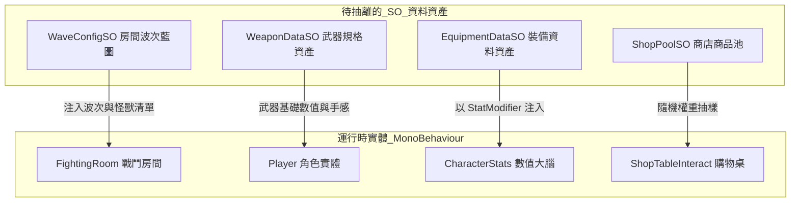

# ScriptableObject (SO) 架構評估與重構交接文檔
> **文檔版本**：v1.0  
> **建立時間**：2026-11-12  
> **關聯系統**：戰鬥房間波次 (`FightingRoom`)、裝備系統 (`Equipment`)、武器系統 (`Weapon`)、商店與掉落池 (`ShopTableInteract`)、中央數值大腦 (`CharacterStats`)

---

## 1. 核心背景與目標

在專案數值統計重構為中央數值大腦（`CharacterStats` + `StatModifier`）之後，專案的底層運算邏輯已成熟。然而，部分上層內容配置（波次、裝備、武器、商店）目前仍採用「在場景物件或 Prefab 上序列化多層 List」的原型期做法。

### 為什麼需要抽離成 ScriptableObject (SO)？
1. **資料與實體解耦**：避免純數值（攻擊力、掉落率）與 GameObject（碰撞體、Renderer、動畫）死鎖在同一個 Prefab 中。
2. **記憶體享元最佳化 (Flyweight Pattern)**：100 個相同的物件共用一份 `.asset` 記憶體參照，而非各自複製一份重複資料。
3. **終結 Inspector 巢狀清單地獄**：消除 4 層甚至更深的多層 List 摺疊，降低誤觸與維護成本。
4. **支援動態組裝與 Roguelike 隨機性**：SO 可以作為卡牌隨機抽取（例如：隨機怪物波次、隨機商店池）。

---

## 2. 四大待重構模組分析與痛點盤點



---

### ① 戰鬥房間波次 (`FightingRoom.cs`)
* **優先級**：★★★★★ (最高 / 最急迫)
* **現狀問題**：
  * [`FightingRoom.cs`](file:///c:/Unity/Dungeon/Assets/Script/Abstract/FightingRoom.cs) 內建 4 層巢狀 List：`List<LevelWaveGroups>` → `List<EnemyWaveGroup>` → `List<EnemyWave>` → `List<SpawnConfig>`。
  * 每個戰鬥房間 Prefab 必須手動設定這 4 層清單，無法在多個房間之間共用相同的波次。
  * 修改某個波次的難度時，必須逐一開啟所有房間 Prefab 修改，極易遺漏。
* **重構設計方案**：
  * 建立 `WaveGroupSO` 與 `WaveDataSO`：
    * 定義波次名稱、怪物配置（包含引用的 `EnemyDataSO`）、產生延遲、生成點索引（SpawnPoint Index 0~3）。
  * `FightingRoom` 只需要留出 Transform 陣列（`Transform[] spawnPoints`），並掛載一個 `[SerializeField] private WaveGroupSO waveConfig;`（或支援 `List<WaveGroupSO>` 進行隨機抽樣）。

---

### ② 裝備系統 (`Equipment.cs`)
* **優先級**：★★★★★ (高 / 銜接新數值系統)
* **現狀問題**：
  * [`Equipment.cs`](file:///c:/Unity/Dungeon/Assets/Script/Interact/Equipment.cs) 掛在場景拾取物上，內嵌 `EquipmentData` 類別，包含了數值（`damage`, `shield`, `health`, `critRate`）、模型 Mesh 與圖示 Sprite。
  * 商店要販售裝備時，必須直接生成一個隱藏的裝備 GameObject 來讀取價格和數值。
* **重構設計方案**：
  * 建立 `EquipmentDataSO`：
    * 包含：裝備名稱、部位枚舉 (`Head`, `Chest`, `Feet`...)、圖示、售價、裝備 Mesh、以及屬性加成清單 (`List<StatModifierConfig>`)。
  * 場上的掉落物只需一個通用的 `ItemPickup` 物件，裡面帶有一個 `EquipmentDataSO` 引用。拾取時，直接向玩家的 `CharacterStats` 註冊 Modifier。

---

### ③ 武器規格系統 (`Weapon.cs`)
* **優先級**：★★★★☆ (中)
* **現狀問題**：
  * [`Weapon.cs`](file:///c:/Unity/Dungeon/Assets/Script/Abstract/Weapon.cs) 同時管理了模型判定、TrailRenderer、音效、HitStop 頓幀秒數、基礎傷害、移速與動畫 Controller。
  * 若要製作「鐵劍」與「名刀」，即使攻擊判定方式一致，仍需複製完整的 Prefab。
* **重構設計方案**：
  * 將純數據抽成 `WeaponDataSO`（基礎傷害、攻擊距離、移速係數、打擊頓幀秒數、打擊音效、AnimatorOverrideController）。
  * 武器 Prefab 專注負責物理接觸與特效表現，進入遊戲或切換武器時自動讀入 SO 設定。

---

### ④ 商店與掉落池 (`ShopTableInteract.cs`)
* **優先級**：★★★★☆ (中)
* **現狀問題**：
  * [`ShoppingTableInteract.cs`](file:///c:/Unity/Dungeon/Assets/Script/Interact/ShoppingTableInteract.cs) 上各自拖拽 `List<GameObject> itemList`。
  * 無法統籌控制地牢第 1 層、第 2 層的物價與品質階級（Common / Rare / Epic）。
* **重構設計方案**：
  * 建立 `ShopPoolSO` / `LootTableSO`，包含帶權重的物品清單 (`List<WeightedItem>`)。
  * 購物桌只需指定屬於哪一個池子，生成時自動走權重隨機抽樣。

---

## 3. 建議重構時程與實作步驟

| 階段 | 改造目標 | 預期效益 | 實施狀態 |
| :--- | :--- | :--- | :--- |
| **Phase 1** | **`FightingRoom` 波次 SO 化** | 解決 4 層清單展開問題；支援波次跨房間複用與隨機抽取 | 待實施 |
| **Phase 2** | **`Equipment` 裝備 SO 化與數值矩陣** | 資料與實體解耦；6 大部位專業化分工；36 件套裝資產全面配置；串接中央數值大腦 | **已完成 (v2.0)** |
| **Phase 3** | **商店與掉落表 SO 化** | 支援關卡進度分層出貨；可一鍵調整掉落率與售價 | 待實施 |
| **Phase 4** | **`Weapon` 規格 SO 化** | 實現「同動作骨架更換數值外觀」，大幅減少武器 Prefab 數量 | 待實施 |

---

## 4. 核心類別設計草案 (Blueprint Reference)

### A. 波次資料配置草案
```csharp
[CreateAssetMenu(fileName = "WaveGroup_", menuName = "Dungeon/Level/Wave Group")]
public class WaveGroupSO : ScriptableObject
{
    public string groupName = "Wave Group 1";
    public List<WaveDataSO> waves = new List<WaveDataSO>();
}

[CreateAssetMenu(fileName = "Wave_", menuName = "Dungeon/Level/Wave Data")]
public class WaveDataSO : ScriptableObject
{
    public string waveName = "Wave 1";
    public float delayBeforeWave = 1.0f;
    public List<WaveSpawnEntry> spawnEntries;
}

[System.Serializable]
public class WaveSpawnEntry
{
    public GameObject enemyPrefab;
    public EnemyDataSO enemyData;
    public int spawnPointIndex; // 房間對應的點位編號
    public bool canBeElite = true;
    public GameObject spawnVfxPrefab;
}
```

### B. 裝備資料配置草案
```csharp
[CreateAssetMenu(fileName = "Equip_", menuName = "Dungeon/Item/Equipment Data")]
public class EquipmentDataSO : ScriptableObject
{
    public string equipmentName;
    public Equipment.EquipmentType slotType;
    public Sprite icon;
    public Mesh mesh;
    public int basePrice;
    
    [Header("屬性加成")]
    public float bonusDamage;
    public float bonusShield;
    public float bonusMaxHealth;
    public float bonusCritRate;
}
```

---
*本文件已歸檔完畢，後續重構可直接依此規格進行排程與施工。*
