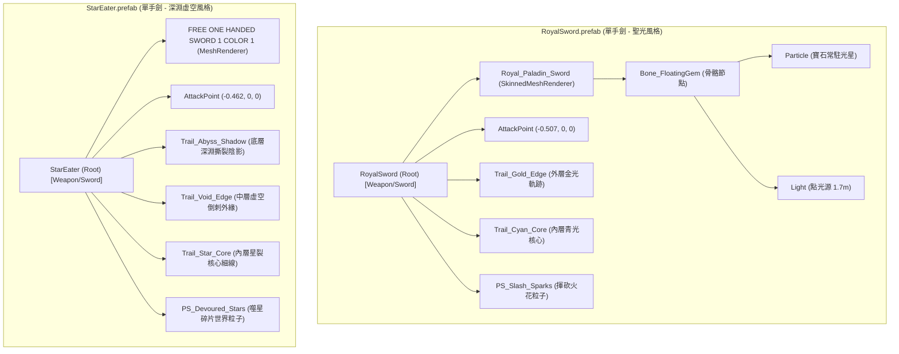

# 大型雙手重武器【岩峰 (Crag)】URP 武器特效規格文檔 (VFX Specification)

---

## 1. 規格文檔概述與設計目標

本規格文檔針對專案中的大型雙手重巨刃 **@Crag.prefab**（岩峰）制定專屬 Universal Render Pipeline (URP) 武器特效設計規範。
透過逆向工程分析已上線之標準單手劍範本 **@RoyalSword.prefab**（皇家英雄劍）與 **@StarEater.prefab**（噬星者），提取其多層次刀光軌跡（TrailRenderer）、粒子碎屑系統（ParticleSystem）、GPU 混合模式與程序化貼圖標準，並精確測量雙手巨刃 Crag 的三維幾何體態，確立符合「沉重重擊、斷層崩解、礦脈迸裂」特性的重武器特效數值與放大倍率規範。

> [!NOTE]
> 本文檔僅作為技術規格與數值指引，嚴格遵守「只寫規格文檔，不直接生成或修改任何預製體與程式腳本」原則。

---

## 2. 已完成範本深度剖析 (RoyalSword & StarEater)

### 2.1 特效階層結構與拓撲對比

兩把完成範本均採用「**武器根節點掛載 + 刀身局部空間對齊 + 動態 Overdrive 驅動**」架構：



#### 結構特徵分析：
1. **RoyalSword**：
   - 特色為具備骨骼蒙皮動畫（`SkinnedMeshRenderer`），其核心護手處掛載懸浮寶石骨骼 `Bone_FloatingGem`（本地座標 `(-0.148, 0, 0)`），掛載常駐點光源與核心微粒。
   - 揮刀軌跡採用 **2 層 Trail**（金光外緣 + 青光核心）與世界座標火花 `PS_Slash_Sparks`。
2. **StarEater**：
   - 確立了成熟的 **3 層 Trail + 1 粒子** 模組化揮砍架構：
     - **Layer 1（底層）**：`Trail_Abyss_Shadow` 負責鋪底厚重體積與深色剪影（採用 Alpha Blend）。
     - **Layer 2（中層）**：`Trail_Void_Edge` 負責外輪廓造型倒刺與高光切割（採用 Additive）。
     - **Layer 3（核心）**：`Trail_Star_Core` 負責能量線束核心（高亮度 Additive）。
     - **Layer 4（環境碎屑）**：`PS_Devoured_Stars` 沿刀身發射被吞噬的星屑。

---

### 2.2 ParticleSystem 各模組啟用狀態詳表

| 模組名稱 (Module) | RoyalSword (`PS_Slash_Sparks`) | StarEater (`PS_Devoured_Stars`) | 功能與設計用意 |
| :--- | :---: | :---: | :--- |
| **Main (InitialModule)** | **啟用** | **啟用** | `duration=0.5s`, `loop=true`, `playOnAwake=false`。RoyalSword 壽命 `0.22~0.42s`, 速度 `0.15~0.6m/s`, 尺寸 `0.025~0.065m`；StarEater 壽命 `0.22~0.45s`, 速度 `0.05~0.35m/s`, 尺寸 `0.025~0.07m`。 |
| **EmissionModule** | **啟用** | **啟用** | RoyalSword: `rateOverTime=25`, `rateOverDistance=35`, `Burst(0.02s, 8~14)`；StarEater: `rateOverTime=25`, `rateOverDistance=45`, `Burst(0.02s, 8~14)`。保證揮刀時沿軌跡均勻撒出微粒，且起刀瞬間有爆發微粒。 |
| **ShapeModule** | **啟用** | **啟用** | 均採用 `Box` 形態。RoyalSword 沿刀身尺寸約 `(0.05, 0.05, 0.70m)`；StarEater 為 `(0.03, 0.03, 0.70m)`，精準貼合單手劍刃長度。 |
| **VelocityOverLifetime** | 關閉 | 關閉 | 避免覆蓋物理速度，微粒運動主要依賴初始速度與 Noise。 |
| **LimitVelocityOverLifetime** | **啟用** | **啟用** | 阻尼減速。RoyalSword: `limit=0.05`, `dampen=1.0`；StarEater: `limit=0.6`, `dampen=0.25`。使甩出之粒子迅速滯空停留，形成視覺拖尾。 |
| **InheritVelocityModule** | 關閉 | 關閉 | 不繼承角色移動速度，防止高速位移時粒子嚴重拉扯變形。 |
| **ForceOverLifetime** | 關閉 | 關閉 | 無額外恆定推力。 |
| **ColorOverLifetime** | **啟用** | **啟用** | 漸變透明度過渡。兩者皆為頭部淡入 (`Alpha 0->1`)、尾部平滑消散 (`Alpha 1->0`)，搭配 HDR 顏色漸變。 |
| **ColorBySpeedModule** | 關閉 | 關閉 | 不依速度動態變色。 |
| **SizeOverLifetime** | **啟用** | **啟用** | 非線性收縮曲線：`0s (0.2~0.35)` 快速展開至 `0.1s (1.0)` 峰值，隨後平緩縮小至 `1.0s (0.0)` 完全歸零。 |
| **SizeBySpeedModule** | 關閉 | 關閉 | 尺寸不與速度連動。 |
| **RotationOverLifetime** | **啟用** | **啟用** | 繞 Z 軸隨機旋轉（RoyalSword `±0.5π`, StarEater `±0.5π`），營造晶屑/碎星翻滾感。 |
| **RotationBySpeedModule** | 關閉 | 關閉 | 不隨線速度連動角速度。 |
| **ExternalForcesModule** | 關閉 | 關閉 | 忽略風力區與外力。 |
| **NoiseModule** | **啟用** | **啟用** | 營造擾動漂移。RoyalSword: `strength=0.18, freq=1.0`；StarEater: `strength=0.18, freq=1.6, scrollSpeed=0.6`。賦予粒子有機懸浮動態。 |
| **Collision / Trigger** | 關閉 | 關閉 | 關閉物理碰撞檢測，大幅降低揮刀時之 CPU 物理耗損。 |
| **SubEmittersModule** | 關閉 | 關閉 | 無次級子發射器。 |
| **TextureSheetAnimation** | 關閉 | 關閉 | 採用單幀貼圖 + Billboard 旋轉，節省貼圖空間。 |
| **Lights / Trails** | 關閉 | 關閉 | 避免大量微粒生成即時點光源與次級軌跡造成 Draw Call 膨脹。 |

---

### 2.3 Renderer 材質球、URP Shader 與 GPU Blend Mode 規格

所有武器特效材質球均統一採用 Unity URP 原生著色器：
`Universal Render Pipeline/Particles/Unlit` (Shader GUID: `0406db5a14f94604a8c57ccfbc9f3b46`)

| 材質球名稱 | 用途層級 | Surface Type | Blend Mode | `_SrcBlend` | `_DstBlend` | Render Queue | HDR BaseColor (`_BaseColor`) |
| :--- | :--- | :--- | :--- | :---: | :---: | :---: | :--- |
| `Mat_VFX_Trail_GoldEdge` | Royal 外層金刃 | Transparent | **Additive** | `SrcAlpha (5)` | `One (1)` | **3000** | `RGBA(1.8, 1.8, 1.8, 1.0)` (金黃漸變) |
| `Mat_VFX_Trail_CyanCore` | Royal 內層青核 | Transparent | **Additive** | `SrcAlpha (5)` | `One (1)` | **3000** | `RGBA(1.8, 1.8, 1.8, 1.0)` (青藍漸變) |
| `Mat_VFX_DiamondFacet` | Royal 揮砍微粒 | Transparent | **Additive** | `SrcAlpha (5)` | `One (1)` | **3000** | `RGBA(1.8, 1.8, 1.8, 1.0)` |
| `Mat_VFX_HolyStar` | Royal 寶石光星 | Transparent | **Additive** | `SrcAlpha (5)` | `One (1)` | **3000** | `RGBA(1.8, 1.8, 1.8, 1.0)` |
| `Mat_VFX_StarEater_AbyssShadow` | StarEater 底層陰影 | Transparent | **Alpha Blend** | `SrcAlpha (5)` | `OneMinusSrcAlpha (10)` | **2999** (QueueOffset: -1) | `RGBA(1.0, 1.0, 1.0, 1.0)` (深紫黑) |
| `Mat_VFX_StarEater_VoidEdge` | StarEater 外緣鋸齒 | Transparent | **Additive** | `SrcAlpha (5)` | `One (1)` | **3000** (QueueOffset: 0) | `RGBA(1.3, 0.7, 1.8, 1.0)` (幽冷紫) |
| `Mat_VFX_StarEater_StarCore` | StarEater 晶裂核心 | Transparent | **Additive** | `SrcAlpha (5)` | `One (1)` | **3001** (QueueOffset: 1) | `RGBA(1.2, 0.9, 1.6, 1.0)` (白亮紫) |
| `Mat_VFX_StarEater_StarSpark` | StarEater 吞噬星屑 | Transparent | **Additive** | `SrcAlpha (5)` | `One (1)` | **3002** (QueueOffset: 2) | `RGBA(2.4, 2.1, 2.8, 1.0)` (超亮紫晶) |

> [!IMPORTANT]
> **渲染排序規範 (Render Queue Hierarchy)**：
> 凡包含「暗色殘影/岩層底色」的 Layer 1 必須設置為 `Alpha Blend` 且 Render Queue 為 **2999**；中層外緣設置為 **3000**；高亮能量核心設置為 **3001**；飄散碎屑設置為 **3002**。此嚴格佇列能保證不透明與半透明像素正確遮蔽疊加，避免 Additive 模式將深色底色錯誤沖淡。

---

### 2.4 貼圖規格、通道設計與 Importer 設置

範本使用的特效貼圖均經由自研 Procedural Texture Generator 生成，規範如下：

| 貼圖檔案名稱 | 尺寸 (WxH) | 格式 | Wrap Mode | Filter Mode | Alpha 透明通道設計特性 |
| :--- | :---: | :---: | :---: | :---: | :--- |
| `Tex_Trail_HolySlash_Edge.png` | 1024 x 256 | RGBA32 | Clamp | Bilinear | 弧狀外緣平滑光刃、尖端高光強收束 |
| `Tex_Trail_HolySlash_Core.png` | 1024 x 256 | RGBA32 | Clamp | Bilinear | 中心高斯光束分布、雙側快速 Feather 羽化 |
| `Tex_Particle_DiamondFacet.png` | 256 x 256 | RGBA32 | Clamp | Bilinear | 菱形多面切角高光星芒 |
| `Tex_Particle_HolyStar.png` | 256 x 256 | RGBA32 | Clamp | Bilinear | 四角星芒柔光暈 |
| `Tex_StarEater_Abyss_Torn.png` | 512 x 128 | RGBA32 | Clamp | Bilinear | 邊緣不規則撕裂碎痕、深淵煙氣噪波遮罩 |
| `Tex_StarEater_Slash_Jagged.png`| 512 x 128 | RGBA32 | Clamp | Bilinear | 7 組非對稱鯊鰭倒刺、齒緣銳化邊光 |
| `Tex_StarEater_Core_Crack.png` | 512 x 64 | RGBA32 | Clamp | Bilinear | 階梯式電裂核心光束 |
| `Tex_StarEater_StarShard.png` | 128 x 128 | RGBA32 | Clamp | Bilinear | 低多邊形星形晶石碎屑 |

- **Texture Importer 標準設定**：
  - `Texture Type`: Default
  - `Alpha Source`: Input Texture Alpha
  - `Alpha is Transparency`: **True**
  - `Mipmap Enabled`: **True** (粒子) / **False** (高精軌跡)
  - `Texture Compression`: Compressed HQ (ASTC / BC7)

---

## 3. 目標重武器【岩峰 (Crag)】幾何測量報告

透過 Unity MCP 深度檢查場景與資產資料庫中的 `@Crag.prefab`，取得其實際三維幾何體積與局部變換矩陣：

### 3.1 武器幾何尺寸與邊界框測量 (Mesh Bounds)

- **原始模型資產**：`Assets/Res/Model/ModularItems/Models/Models Original 1.0/FREE GREAT SWORD 3 COLOR 3.fbx`
- **模型 Mesh Filter**：`FREE GREAT SWORD 3 COLOR 3` (GUID: `d338fcbc108455d43965d535eb599983`)
- **網格本地邊界框 (Mesh Local Bounds)**：
  - `Center`: `(0.0467m, 0.0000m, 0.4969m)`
  - `Size`: `(0.6679m, 0.1731m, 2.2936m)`
- **武器主體測量數值**：
  - **武器總長度 (Total Length)**：**2.294 公尺** (229.4 cm)
    *(相較於單手劍 RoyalSword 的 1.337m，長度擴增至 **1.716 倍**)*
  - **最大刀身寬度 (Max Blade Width)**：**0.668 公尺** (66.8 cm，含外凸梯形崩口岩角)
    *(刀身主體平坦段寬度約 **0.380 公尺**，相較於單手劍的 0.150m，寬度擴增至 **2.53 ~ 4.45 倍**)*
  - **刀身厚度 (Thickness)**：**0.173 公尺** (17.3 cm，極具份量感的厚重巨石斷面)
  - **整劍預製體包圍盒 (Prefab Combined BoxCollider)**：
    - `Center`: `(-0.487m, -0.033m, 0.063m)`
    - `Size`: `(2.372m, 1.019m, 0.473m)`

---

### 3.2 關鍵特徵點本地座標 (Local Position) 精確記錄

Crag 武器模型的子物件 `FREE GREAT SWORD 3 COLOR 3` 在預製體根節點下帶有複合旋轉：
- 本地旋轉四元數：`(-0.4233, -0.5084, 0.5647, 0.4934)` (歐拉角：`X: 8.997°, Y: 277.248°, Z: 89.774°`)
- 刀身沿向單位向量 (Blade Forward Vector)：$\vec{V}_{\text{blade}} = (-0.9798, -0.1564, 0.1246)$
- 劍刃法線向上向量 (Blade Up Vector)：$\vec{V}_{\text{up}} = (-0.1268, 0.0039, -0.9919)$
- 刀面橫向向右向量 (Blade Right Vector)：$\vec{V}_{\text{right}} = (-0.1546, 0.9877, 0.0236)$

基於此變換矩陣，精確測得預製體本地座標系（Crag Local Space）下的關鍵點位如下：

| 特徵部位 (Feature Point) | 本地座標 (Local Position) | 距武器握持原點距離 | 功能與特效定位意義 |
| :--- | :--- | :---: | :--- |
| **手柄握持原點 (Grip Origin)** | `(0.013, -0.001, 0.000)` | 0.013 m | 角色雙手握把中心基準點。 |
| **護手螺旋核心 (Guard Core)** | `(-0.183, -0.032, 0.025)` | 0.187 m | 劍格/護手處金色赭石螺旋礦核心起點，玄武岩刃根發源處。 |
| **碎岩微粒發射中點 (Blade Mid)** | `(-1.127, -0.180, 0.143)` | 1.150 m | 刀身實體中段重心位置，`PS_Crag_Debris` 盒狀發射器中心。 |
| **打擊判定中心 (AttackPoint)** | `(-0.858, -0.091, 0.131)` | 0.873 m | 戰鬥 Hitbox 判定球中心，配置 `attackRadius = 0.75m`。 |
| **幾何實體刀尖 (Physical Tip)** | `(-1.612, -0.212, 0.206)` | 1.639 m | 3D 模型網格最前端頂點所在位置。 |
| **特效封套刀尖 (VFX Outer Tip)** | `(-1.666, -0.266, 0.212)` | **1.700 m** | `Trail_Crag_Edge` 刀光尖端掛載點，向外包覆 Hitbox 外緣 (1.61m)。 |
| **劍柄末端配重球 (Pommel End)** | `(+0.650, +0.101, -0.081)` | 0.663 m | 劍柄尾端配重端點（網格 Z 軸 -0.65m 處）。 |

---

### 3.3 現有子物件結構與材質槽配置

`Crag.prefab` 當前在專案中的物件拓撲與組件配置清單：

```
Crag (Root, Layer: 12 Weapon)
 ├── Rigidbody (Mass: 1, CenterOfMass: [-0.487, 0.009, 0.062])
 ├── BoxCollider (Size: [2.372, 1.019, 0.473])
 ├── DropsInteract (interactableName: "岩峰")
 ├── ShopWeapon (price: 10, weight: 1)
 ├── Sword (damage: 50, weaponType: 2[雙手巨劍], sound: GSword, override: TwoHandOverride)
 │     ├── attackPoint ──> AttackPoint
 │     ├── weaponTrails ─> [Trail_Basalt_Slab, Trail_Crag_Edge, Trail_Ochre_Vein]
 │     └── weaponEffect ─> PS_Crag_Debris
 │
 ├── AttackPoint [LocalPos: (-0.858, -0.091, 0.131)]
 ├── FREE GREAT SWORD 3 COLOR 3 [LocalPos: (0.013, -0.001, 0.0)]
 │     ├── MeshFilter: FREE GREAT SWORD 3 COLOR 3 (GUID: d338fcbc108455d43965d535eb599983)
 │     └── MeshRenderer:
 │           └── [Material Slot 0]: Base Palette Material URP.mat (GUID: 9845b38987b69224ca6524623f877af8)
 ├── Trail_Basalt_Slab [LocalPos: (-1.254, -0.200, 0.159)] (TrailRenderer - Layer 1 底層玄武岩)
 ├── Trail_Crag_Edge   [LocalPos: (-1.666, -0.266, 0.212)] (TrailRenderer - Layer 2 外緣崩口)
 ├── Trail_Ochre_Vein  [LocalPos: (-1.450, -0.231, 0.184)] (TrailRenderer - Layer 3 核心礦脈)
 └── PS_Crag_Debris    [LocalPos: (-1.127, -0.180, 0.143)] (ParticleSystem - Layer 4 崩裂岩屑)
```

---

## 4. 重武器專屬放大倍率建議與數值規範

雙手巨劍具有**劍身超長、劍刃寬闊、揮擊角速度沉重緩慢、打擊衝量巨大**等力學特點。若直接沿用單手劍的特效數值，刀光將顯得單薄細弱、微粒過於輕浮飄忽。以下制定精確放大倍率建議：

### 4.1 物理與戰鬥特性對比基礎

| 屬性項目 | 單手劍範本 (RoyalSword) | 雙手重武器 (Crag) | 物理差異與視覺訴求 |
| :--- | :---: | :---: | :--- |
| **武器傷害 (Damage)** | 30 | **50** (+66.7%) | 具毀滅性的重擊數值，特效需展現碎石崩裂之力量感。 |
| **武器類型 (WeaponType)** | 0 (單手劍) | **2 (雙手重武器)** | 攻擊動作為大開大闔的重揮砍與下劈。 |
| **移動速度 (Run/Walk)** | 7.0 / 3.0 | **4.0 / 2.0** (-43%) | 移動笨重，攻擊前後搖長，刀光必須具備更長的停留殘影。 |
| **攻擊半徑 (AttackRadius)**| 0.70 m | **0.75 m** (攻擊中心更遠) | 打擊覆蓋半徑外達 1.62m，刀光包覆範圍必須擴大。 |
| **揮砍掃掠體積** | 約 $1.2\text{m} \times 0.2\text{m}$ | 約 $\mathbf{2.3\text{m} \times 0.7\text{m}}$ | 掃掠空間體積約為單手劍的 **3.5 ~ 4.0 倍**。 |

---

### 4.2 Trail 刀光軌跡寬度與層次倍率建議 (Trail Width Multipliers)

> 基準參照：RoyalSword 外層刀光寬度為 **0.36m**，內層核心寬度為 **0.22m**。

```
[RoyalSword 0.36m]  ██████████
[Crag Vein 0.40m]   ███████████ (1.82x vs RoyalCore)
[Crag Edge 0.92m]   █████████████████████████ (2.56x vs RoyalEdge)
[Crag Slab 1.30m]   ████████████████████████████████████ (3.61x vs RoyalEdge)
```

1. **Layer 1：玄武岩層殘影 (`Trail_Basalt_Slab`)**
   - **建議寬度**：**1.30 公尺**（相較於 RoyalSword 外刃放大 **3.61 倍**）
   - **掛載位置**：`(-1.254, -0.200, 0.159)` (刀身中外段 1.28m 處)
   - **作用**：寬度達 1.30m 的廣域 Alpha Blend 鋪底，覆蓋 0.63m ~ 1.93m 之攻擊弧面，展現厚重巨石的黑色拖影與岩層斷理。
2. **Layer 2：岩峰崩口刀刃 (`Trail_Crag_Edge`)**
   - **建議寬度**：**0.92 公尺**（相較於 RoyalSword 外刃放大 **2.56 倍**）
   - **掛載位置**：`(-1.666, -0.266, 0.212)` (刀尖封套點 1.70m 處)
   - **作用**：以 Additive 梯形岩石崩口造型為刀鋒外緣定型，覆蓋 1.24m ~ 2.16m 空間，形成冷冽金黃的鋒芒。
3. **Layer 3：赭黃礦脈核心 (`Trail_Ochre_Vein`)**
   - **建議寬度**：**0.40 公尺**（相較於 RoyalSword 核心放大 **1.82 倍**）
   - **掛載位置**：`(-1.450, -0.231, 0.184)` (能量脈絡點 1.48m 處)
   - **作用**：呼應巨劍中央鑲嵌之金色結晶礦脈，以 0.40m 緊束光帶呈現高熱裂紋。

---

### 4.3 Trail 滯留時間倍率建議 (Trail Lifetime / Time)

- **單手劍基準**：RoyalSword 刀光滯留時間約 **0.12s ~ 0.16s**（代碼修正版，高速輕快收束）。
- **重武器建議**：
  - `Trail_Basalt_Slab`（底層岩塊）：**0.38 秒**（放大 **2.38 倍** / 相較預製體 0.25s 放大 1.52 倍）
  - `Trail_Crag_Edge`（崩口刀鋒）：**0.32 秒**（放大 **2.00 倍**）
  - `Trail_Ochre_Vein`（礦脈光核）：**0.24 秒**（放大 **1.50 倍**）
- **設計用意**：
  雙手巨劍揮動週期長達 0.6 ~ 0.9 秒，若 Trail 壽命低於 0.2 秒，揮砍時刀尾會過早中斷，無法形成完整的 180 度重斬圓弧。0.32~0.38 秒的遞減殘影能營造「巨石破空、空氣受壓撕裂」的重量慣性感。

---

### 4.4 崩裂岩屑粒子系統放大倍率建議 (Particle System Scaling)

> 基準參照：RoyalSword 揮砍粒子 `PS_Slash_Sparks` 與 StarEater `PS_Devoured_Stars`。

| 參數項目 (Parameter) | RoyalSword 基準值 | Crag 重武器建議值 | 建議放大倍率 | 制定依據與視覺力學分析 |
| :--- | :---: | :---: | :---: | :--- |
| **發射器範圍 (Shape Box)** | `(0.05, 0.05, 0.70m)` | `(0.10, 0.12, 1.45m)` | **長度 2.07 倍** / 體積 9.9x | 巨劍刃長由 0.85m 增加至 1.64m，微粒生成盒長度需擴展至 1.45m，覆蓋 0.42m ~ 1.87m 刀身長度。 |
| **移動發射率 (Rate Over Distance)**| 35 顆/公尺 | **42 顆/公尺** | **1.20 倍** | 巨劍線速度大，適度增加距離發射率以維持飛行路徑上的岩屑密度，避免斷點。 |
| **起刀爆發數 (Burst Count)** | 8 ~ 14 顆 | **12 ~ 18 顆** | **1.36 倍** | 揮動起步需呈現「巨力震碎岩塊」之起手崩解爆發感。 |
| **微粒初始尺寸 (Start Size)** | `0.025 ~ 0.065 m` | **`0.045 ~ 0.110 m`** | **1.70 ~ 1.80 倍** | 單手劍微粒為細小火星（2.5~6.5cm），巨刃微粒必須為具備多面切角的「立體碎石與礦石塊」（4.5~11cm），清晰可辨。 |
| **初始速度 (Start Speed)** | `0.15 ~ 0.60 m/s` | **`0.20 ~ 0.95 m/s`** | **1.58 倍** | 巨劍揮舞離心力強大，碎石被拋射之初速更高。 |
| **微粒生命週期 (Lifetime)** | `0.22 ~ 0.42 s` | **`0.25 ~ 0.52 s`** | **1.24 倍** | 碎石掉落需足夠時間展現下墜拋物線，故生命週期上限提升至 0.52s。 |
| **重力加速度 (Gravity Modifier)** | 0.08 (漂浮火花) | **0.65 (沉重岩石)** | **8.13 倍** | **關鍵手感差異**：火星幾無重量微幅上飄，碎石岩晶具有質量，飛濺後受強重力快速砸向下墜。 |
| **阻尼速度上限 (Limit Velocity)** | 0.05 m/s | **0.50 m/s** | **10.0 倍** | 允許碎石保持一定向外飛濺動量，而非像細煙霧般瞬間定格。 |
| **旋轉角速度 (Rotation Over Lifetime)**| `±0.50 π` rad/s | **`±1.20 π` rad/s** | **2.40 倍** | 不規則幾何碎石在空中翻滾頻率更高，反光切面閃爍更劇烈。 |

---

### 4.5 總結規格速查表 (Quick Reference Summary Matrix)

下表為為【岩峰 (Crag)】配置特效時之核心數值總綱速查矩陣：

```
+==================================================================================================+
|                               CRAG VFX SPECIFICATION MATRIX                                     |
+======================+===================================+=======================================+
| 模組 / 項目           | 實體參數值                        | 備註說明                              |
+======================+===================================+=======================================+
| 刀身總長度 / 寬度    | Length: 2.294m / Width: 0.668m    | 比單手劍長 1.72x、寬 2.53~4.45x       |
| 刀身朝向向量         | (-0.9798, -0.1564, 0.1246)        | Crag 局部座標系刀身前進軸             |
| 刀尖定位點 (Tip)     | (-1.666, -0.266, 0.212)           | 距離原點 1.70m，包覆 1.62m Hitbox     |
| 護手核心點 (Guard)   | (-0.183, -0.032, 0.025)           | 距離原點 0.187m，金色螺旋核心起點     |
+----------------------+-----------------------------------+---------------------------------------+
| Trail 1 (Basalt Slab)| W: 1.30m / T: 0.38s / Queue: 2999 | Alpha Blend 玄武岩厚重底層 (3.61x寬)  |
| Trail 2 (Crag Edge)  | W: 0.92m / T: 0.32s / Queue: 3000 | Additive 梯形崩口刀刃 (2.56x寬)       |
| Trail 3 (Ochre Vein) | W: 0.40m / T: 0.24s / Queue: 3001 | Additive 赭黃電裂礦脈 (1.82x寬)       |
+----------------------+-----------------------------------+---------------------------------------+
| PS Size (Start Size) | 0.045m ~ 0.110m                   | 1.75x 放大，呈現實體礦石碎塊          |
| PS Emission Rate     | OverDist: 42 / Burst: 12~18       | 1.25x 爆發，分布於 1.45m 發射盒 (2.1x)|
| PS Gravity Modifier  | 0.65                              | 8.13x 重力加權，碎石沉重下墜          |
| PS Lifetime          | 0.25s ~ 0.52s                     | 1.24x 延長，滿足拋物線落地演繹        |
+======================+===================================+=======================================+
```

---
*文檔撰寫完成日期：2026-11-08*  
*適用管線：Universal Render Pipeline (URP)*  
*文檔存檔路徑：`VFX_Spec_Crag.md`*
