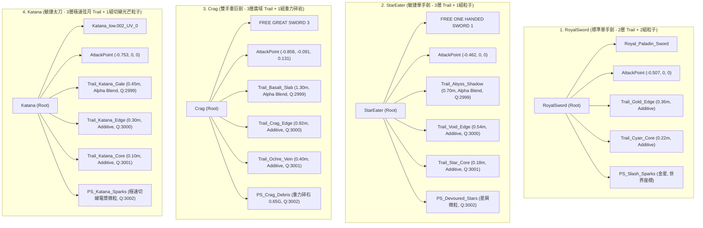

# 敏捷型近戰武器【太刀 (Katana)】URP 武器特效規格文檔

---

## 1. 文檔定位與後續交接說明 (Handoff Purpose & Context)

本規格文檔旨在為專案中尚未實作專屬高品質 URP 武器特效之敏捷型快速連擊武器 **[Katana.prefab](file:///c:/Unity/Dungeon/Assets/Prefab/Weapon/Katana.prefab)**（太刀 / Thermal Katana）制定完整的 Universal Render Pipeline (URP) 特效規格標準。

專案內目前已完成或已規劃多把代表性武器範本：
1. **[RoyalSword.prefab](file:///c:/Unity/Dungeon/Assets/Prefab/Weapon/RoyalSword.prefab)**（皇家英雄劍，標準單手劍，聖光晶體風格）
2. **[StarEater.prefab](file:///c:/Unity/Dungeon/Assets/Prefab/Weapon/StarEater.prefab)**（噬星者，敏捷單手劍，深淵虛空倒刺風格）
3. **[Daybreak.prefab](file:///c:/Unity/Dungeon/Assets/Prefab/Weapon/Daybreak.prefab)**（破曉，輕型單手劍，晨曦疾風羽刃風格）
4. **[Crag.prefab](file:///c:/Unity/Dungeon/Assets/Prefab/Weapon/Crag.prefab)**（岩峰，雙手重巨劍，玄武斷層碎岩風格）
5. **[TitansTooth.prefab](file:///c:/Unity/Dungeon/Assets/Prefab/Weapon/TitansTooth.prefab)**（泰坦之牙，雙手重巨刃，史前獸牙骨刺撕咬風格）

本檔將前述已完成武器的特效階層拓撲、Renderer 材質球設定、GPU 混合模式（Blend Mode）、ParticleSystem 模組參數與貼圖規範進行系統化橫向對比；同時透過 Unity MCP 工具精確測量 **Katana** 的網格體態、刀身向量與關鍵座標點，並依據其高移動速度（`runSpeed: 10`）、4 段連擊動作（`totalComboSteps: 4`）與極致鋒利的刀身力學，制定最合適的縮放倍率、殘影滯留時間與多層特效架構，供後續對話或開發者直接交接製作使用。

> [!NOTE]
> 本任務嚴格執行規格分析與數值設計，**不對工程中的預製體、腳本代碼、材質球或貼圖進行任何生成與修改**。後續實作請參考第 7 章與第 9 章執行交接。

---

## 2. 全武器範本技術規格橫向對比 (Cross-Weapon Comparative Analysis)

### 2.1 武器特性與定位綜覽

| 武器名稱 | 預製體路徑 | 武器類型 (`weaponType`) | 基礎傷害 (`damage`) | 連擊段數 (`combo`) | 移動速度 (`run/walk`) | 動畫控制器 (`overrideController`) | 視覺與特效主題風格 |
| :--- | :--- | :---: | :---: | :---: | :---: | :---: | :--- |
| **RoyalSword** (英雄劍) | [RoyalSword.prefab](file:///c:/Unity/Dungeon/Assets/Prefab/Weapon/RoyalSword.prefab) | 0 (單手劍) | 30 | 3 | 7.0 / 3.0 | `OneHandOverride` | 聖光十字、青藍核心能量、金色光刃、懸浮寶石呼吸。 |
| **StarEater** (噬星者) | [StarEater.prefab](file:///c:/Unity/Dungeon/Assets/Prefab/Weapon/StarEater.prefab) | 0 (單手劍) | 30 | 5 | 7.0 / 3.0 | `OneHandOverride` | 深淵撕裂暗影、虛空幽紫鯊鰭倒刺、星裂電核、吞噬星屑。 |
| **Daybreak** (破曉) | [Daybreak.prefab](file:///c:/Unity/Dungeon/Assets/Prefab/Weapon/Daybreak.prefab) | 0 (單手劍) | 30 | 3 | 7.5 / 3.2 | `OneHandOverride` | 晨曦破曉、黑曜暮影風帶、金色後掠羽翼鋸齒、羽芒星屑。 |
| **Crag** (岩峰) | [Crag.prefab](file:///c:/Unity/Dungeon/Assets/Prefab/Weapon/Crag.prefab) | 2 (雙手巨劍) | 50 | 3 | 4.0 / 2.0 | `TwoHandOverride` | 厚重玄武岩層殘影、梯形崩口刀刃、沉重碎岩拋射 (0.65G)。 |
| **TitansTooth** (泰坦之牙) | [TitansTooth.prefab](file:///c:/Unity/Dungeon/Assets/Prefab/Weapon/TitansTooth.prefab) | 2 (雙手巨刃) | 40 | 3 | 5.0 / 3.0 | `TwoHandOverride` | 遠古泰坦巨獸象牙、野性撕裂、原始琥珀裂紋、骨刺飛濺 (0.45G)。 |
| **Katana** (太刀) | [Katana.prefab](file:///c:/Unity/Dungeon/Assets/Prefab/Weapon/Katana.prefab) | **1 (太刀)** | **20** | **4** | **10.0 / 4.0** | `OneHandOverride` | **極致居合弦月刀光、高頻電漿熾刃、微秒收刀殘心、極速刀芒微粒。** |

---

### 2.2 特效階層拓撲與掛載架構對比



---

### 2.3 TrailRenderer 軌跡系統詳細參數矩陣

| 參數項目 | RoyalSword (單手劍) | Crag (雙手重劍) | TitansTooth (雙手重刃) | Katana (敏捷太刀建議規格) | 太刀相較於其他武器之設計特徵 |
| :--- | :--- | :--- | :--- | :--- | :--- |
| **軌跡層數 (Layers)** | 2 層 | 3 層 | 3 層 | **3 層** (底風帶 + 主弦月刃 + 電漿核) | 維持 URP 3 層最佳視覺架構，兼顧深度與發光層次。 |
| **主刃外緣寬度 (Edge Width)** | `0.36m` | `0.92m` | `0.80m` | **`0.30m`** | 太刀刀身極薄（3.8cm），寬度緊湊收束，凸顯鋒芒俐落感。 |
| **核心光束寬度 (Core Width)** | `0.22m` | `0.40m` | `0.32m` | **`0.10m`** | 高密度電漿雷射細絲，寬度縮小為單手劍的 **45%**。 |
| **底層氣流寬度 (Aura Width)** | 無 (僅2層) | `1.30m` | `1.15m` | **`0.45m`** | 提供破空半月真空帶，面積約為重劍的 **35%**，避免連擊混亂。 |
| **滯留時間 (Time)** | `0.12s ~ 0.16s` | `0.32s ~ 0.38s` | `0.28s ~ 0.34s` | **`0.09s ~ 0.14s`** | **全武器中最短滯留**，4 段連擊動作快速切換不拖泥帶水。 |
| **寬度衰減曲線 (WidthCurve)** | 頭部 `0.9` -> 峰值 `1.0` -> 尾端 `0.15` | 頭部 `0.85` -> 峰值 `1.0` -> 尾端留厚 `0.55` | 頭部 `0.80` -> 峰值 `1.0` -> 尾端留厚 `0.40` | **頭部 `0.95` -> 峰值 `1.0 (0.1t)` -> 尾端尖針收束 `0.02`** | **極致針尖收束**，呈現如居合斬般首尾呼應的半月柳葉弧光。 |
| **拐角與端點平滑度** | 角頂點: 4, 端點: 2 | 角頂點: 4, 端點: 2 | 角頂點: 4, 端點: 2 | **角頂點: 4, 端點頂點: 2** | 快速變向大角度橫斬與突刺時保證曲面無折角破碎。 |
| **最小頂點距離 (MinVertexDist)**| `0.015m` | `0.015m` | `0.015m` | **`0.012m`** | 太刀揮速極高，適度微調提高採樣頻率，軌跡更圓潤。 |
| **對齊方式與貼圖模式** | View / Stretch | View / Stretch | View / Stretch | **View / Stretch** | 保證視角朝向一致，UV 完美拉伸貼合整個弧長。 |

---

### 2.4 ParticleSystem 各模組啟用狀態與參數對比

| 模組 (Module) | RoyalSword (`PS_Slash_Sparks`) | Crag (`PS_Crag_Debris`) | Katana (`PS_Katana_Sparks` 建議值) | 敏捷太刀微粒動力學分析 |
| :--- | :--- | :--- | :--- | :--- |
| **Main (週期/循環)** | `0.5s` / 循環 / 不喚醒播放 | `0.5s` / 循環 / 不喚醒播放 | **`0.35s` / 循環 / 不喚醒播放** | 週期縮短至 0.35s，精準匹配 4-hit 高頻揮砍節奏。 |
| **生命週期 (Lifetime)** | `0.22 ~ 0.42 s` | `0.25 ~ 0.52 s` | **`0.10 ~ 0.22 s`** | 極速消退（約單手劍的 **45%**），瞬間閃爍後消散，無殘留雜點。 |
| **初始速度 (Speed)** | `0.15 ~ 0.60 m/s` | `0.20 ~ 0.95 m/s` | **`1.20 ~ 2.60 m/s`** | **大幅提升初速（3.5 ~ 4.2 倍）**，呈現刀刃切線高速離心拋射感。 |
| **初始尺寸 (Size)** | `0.025 ~ 0.065 m` (星芒) | `0.045 ~ 0.110 m` (巨石塊) | **`0.015 ~ 0.040 m` (微細光屑/切線火星)** | 極致纖細（約重劍碎塊的 **25%**），維持畫面清爽銳利。 |
| **重力加速度 (Gravity)** | `0.08` (極輕浮) | `0.65` (沉重下墜) | **`0.02` (超輕離子飄逸)** | 幾無重力下墜，在空氣中受衝擊波擴散而非落地。 |
| **發射器形態 (Shape)** | Box: `(0.05, 0.05, 0.70m)` | Box: `(0.10, 0.12, 1.45m)` | **Box: `(0.03, 0.03, 1.15m)`** | 纖細長條盒體，精準包覆太刀刃長 1.24m 範圍。 |
| **距離發射率 (OverDistance)**| 35 顆/m | 42 顆/m | **48 ~ 52 顆/m** | 提高位移發射密度，高速連招時光點密織成線。 |
| **單次爆發 (Bursts)** | `8 ~ 14 顆` (0.02s) | `12 ~ 18 顆` (0.02s) | **`12 ~ 16 顆` (0.01s)** | 起刀 0.01s 瞬發，爆發反應更快。 |
| **阻尼上限 (LimitVelocity)** | `0.05 m/s` | `0.50 m/s` | **`0.60 m/s`** | 允許微粒高速衝出後在空氣中微幅制動。 |
| **隨機擾動 (Noise)** | `Strength: 0.18, Freq: 1.0` | `Strength: 0.14, Freq: 1.4` | **`Strength: 0.10, Freq: 2.2`** | 低強度高頻率，呈現高頻電漿震顫或刀芒直線穿刺。 |
| **旋轉翻滾 (Rotation)** | `±0.50 π` rad/s | `±1.20 π` rad/s | **`±1.50 π` rad/s** | 超高速翻轉，高光閃爍更加緊密。 |
| **禁用模組** | Velocity, Inherit, Force, Collision, Trigger, SubEmitters, Lights, Trails | 同左 | **嚴格禁用** | 嚴格防範高頻連招造成的 DrawCall 與 GC 峰值。 |

---

### 2.5 URP 材質球、GPU Blend Mode 與 Render Queue 規範

所有武器特效材質球均統一基於 URP 官方粒子著色器：
`Universal Render Pipeline/Particles/Unlit` (GUID: `0406db5a14f94604a8c57ccfbc9f3b46`)

```
+-------------------------------------------------------------------------------------------------------+
| 層級 (Layer)         | 材質命名範例                  | 混合模式 (Blend) | Src/Dst Blend | 渲染隊列 (Queue)       |
+---------------------+------------------------------+------------------+---------------+-----------------------+
| Layer 1: 疾風破空底影 | Mat_VFX_Katana_GaleShadow    | Alpha Blend      | SrcAlpha/OneMinusSrcAlpha (5/10) | 2999 (QueueOffset: -1) |
| Layer 2: 居合弦月外刃 | Mat_VFX_Katana_CrescentEdge  | Additive         | SrcAlpha/One (5/1)              | 3000 (QueueOffset:  0) |
| Layer 3: 高頻電漿核心 | Mat_VFX_Katana_PlasmaCore    | Additive         | SrcAlpha/One (5/1)              | 3001 (QueueOffset: +1) |
| Layer 4: 刀芒微粒星火 | Mat_VFX_Katana_SparkParticle | Additive         | SrcAlpha/One (5/1)              | 3002 (QueueOffset: +2) |
+-------------------------------------------------------------------------------------------------------+
```

---

### 2.6 貼圖紋理標準與通道設計

所有貼圖均採用程序化貼圖生成器（Procedural Texture Generator）產出：
* **解析度架構**：
  * 主軌跡外緣（Layer 1 / Layer 2）：`512 x 128` 或 `1024 x 256`（4:1 長條比）。
  * 核心能量束（Layer 3）：`512 x 64`（8:1 超窄高光束）。
  * 碎屑星芒（Layer 4）：`128 x 128`（1:1 正方形細微星鑽/針刺狀刀芒）。
* **UV 映射規範 (LineTextureMode.Stretch)**：
  * $U$ 軸：沿刀身揮砍軌跡長度，$U=0$ 為刀鋒起揮點（刀頭），$U=1$ 為消散尾梢（刀尾）。
  * $V$ 軸：垂直刀身橫向，$V=0.5$ 為中心刀刃脊線，$V=0$ 與 $V=1$ 為向兩側羽化邊界。
* **Alpha 通道衰減曲線**：
  * 太刀採用 **極速啟動 (Instant-On)**：$U=0 \sim 0.02$ 即爬升至 1.0。
  * 尾端採用 **指針尖刺衰減 (Needle-Tip Fade)**：$U > 0.40$ 即展開非線性指數收束，在 $U=1.0$ 處完全收斂為尖銳端點。

---

## 3. 目標武器【太刀 (Katana)】幾何分析與精確測量數據

透過 Unity MCP 工具檢測場景實體與預製體 `[Katana.prefab](file:///c:/Unity/Dungeon/Assets/Prefab/Weapon/Katana.prefab)` 之完整幾何與組件結構：

### 3.1 網格資產與本地邊界框 (Mesh Bounds)

* **模型資產路徑**：`Assets/GameAssets/Import/Thermal_Katana/meshes/Katana_low.002_UV_0_0_0.asset` (GUID: `e6154bc1d7b9b1049aab3269384aacef`)
* **材質球資產路徑**：`Assets/GameAssets/Import/Thermal_Katana/materials/material_0.mat` (GUID: `6c55b781e4186c14283b6e27cf81d68a`)
* **網格模型本地包圍盒 (Mesh Local Bounds)**：
  - `Center`: `(-0.4930m, 0.0000m, 0.0031m)`
  - `Size`: `(1.4957m, 0.0508m, 0.1356m)`
* **武器預製體根節點空間包圍盒 (Parent Space Bounds)**：
  - 子物件 `Katana_low.002_UV_0` 帶有局部旋轉四元數 `(-0.7071, 0, 0, 0.7071)`（即繞 X 軸旋轉 -90°）。
  - 換算至根節點空間後之邊界參數：
    - `Center`: `(-0.4930m, +0.0031m, 0.0000m)`
    - `Size`: `(1.4957m, 0.1356m, 0.0508m)`

---

### 3.2 武器長度、寬度、厚度與刀身向量分析

```
  +X (柄首 Kashira: +0.255m)
   |
   |==== [柄 Tsuka 25.5cm] ====(0,0,0)握持原點
                                 |--- 鍔 Tsuba (-0.020m)
                                 |--- 鎺 Habaki (-0.050m)
                                 |
                                 |
                                 |===== [刃 Nagasa 124.1cm (反り Sori 弧度 13.56cm)] =====
                                 |
                                 |--- 擊打判定 AttackPoint (-0.753m)
                                 |--- 舊版特效 vfx (-1.119m)
                                 |
                                 v
                              -X (鋒 Kissaki: -1.241m) ---> 刀光封套頂點 (-1.260m)
```

* **武器總長度 (Total Length)**：**1.496 公尺**（約 149.6 cm）
  - 劍柄長度（$X=0$ 至 $+0.255\text{m}$）：**0.255 公尺**（25.5 cm，標準雙手/單手兩用太刀柄長）。
  - 刀身長度（$X=0$ 至 $-1.241\text{m}$）：**1.241 公尺**（124.1 cm，長刃大太刀/熱能野太刀規格）。
  - 與其他武器長度對比：為單手劍 RoyalSword (1.337m) 的 **1.12 倍**；約為重劍 Crag (2.294m) 的 **65%**。
* **刀身寬度與反り弧度跨度 (Blade Width & Curve Span)**：
  - **包圍盒 Y 跨度**：**0.1356 公尺**（13.56 cm，此數值包含刀刃本身寬度以及日式太刀獨有的「反り (Sori)」後掠弧度彎曲跨度）。
  - **刀刃實體肉厚寬度 (Mune to Ha)**：約 **0.035 ~ 0.038 公尺**（3.5 ~ 3.8 cm，極薄刃口）。
* **刀身厚度與刀鍔跨度 (Thickness & Tsuba Span)**：
  - **包圍盒 Z 跨度**：**0.0508 公尺**（5.08 cm，即圓形刀鍔 Tsuba 護手直徑）。
  - **刀背脊厚 (Kasane)**：約 **0.007 ~ 0.009 公尺**（7 ~ 9 mm，極致薄刃低風阻）。
* **刀身朝向向量 (Coordinate Alignment)**：
  - 刀尖延伸向量 (Blade Forward Vector)：$$\vec{V}_{\text{forward}} = (-1, 0, 0)$$
  - 刃口弧度向上向量 (Blade Up Vector)：$$\vec{V}_{\text{up}} = (0, 1, 0)$$
  - 刀鍔橫向向右向量 (Blade Right Vector)：$$\vec{V}_{\text{right}} = (0, 0, 1)$$
  *(註：Katana 幾何完全正交對齊於座標軸，無 Crag 或 TitansTooth 的微幅空間傾角，定位極度純粹精準。)*

---

### 3.3 關鍵特徵點本地座標 (Local Position) 精確記錄

| 特徵部位 (Feature Point) | 本地座標 (Local Position) | 距握把原點距離 | 特效配置定位用途說明 |
| :--- | :--- | :---: | :--- |
| **手柄握持原點 (Grip Origin)** | `(0.000, 0.000, 0.000)` | 0.000 m | 太刀握把前端，角色右手綁定標準錨點。 |
| **柄首配重末端 (Kashira Butt)** | `(+0.255, 0.000, 0.000)` | 0.255 m | 刀柄最底端，包圍盒正向極值點。 |
| **刀鍔圓形護手 (Tsuba Guard)** | `(-0.020, 0.000, 0.000)` | 0.020 m | 刀柄與刀刃交接處之護手盤，能量電路源頭。 |
| **刀鎺金屬環 (Habaki Collar)** | `(-0.050, 0.000, 0.000)` | 0.050 m | 刀刃真正出鞘起始點，刀光底層風帶起始端。 |
| **刀身實體中段 (Blade Center)** | `(-0.750, 0.015, 0.000)` | 0.750 m | 刀身物理重心段，`PS_Katana_Sparks` 發射盒中心。 |
| **打擊判定中心 (AttackPoint)** | `(-0.753, 0.000, 0.000)` | 0.753 m | 武器戰鬥 Hitbox 判定球中心，配置 `attackRadius = 0.60m`。 |
| **舊版單層特效點 (Legacy vfx)** | `(-1.119, 0.022, 0.000)` | 1.119 m | 舊版 TrailRenderer 掛載點，後續需徹底替換。 |
| **幾何實體刀尖 (Physical Kissaki)**| `(-1.241, 0.035, 0.000)` | 1.241 m | 刀尖最前端頂點（包圍盒負向極值點）。 |
| **建議刀光外刃掛載點 (Trail Edge)**| `(-1.260, 0.030, 0.000)` | **1.260 m** | 外層刀光發射點，向外微凸 2cm 完美包覆實體刃尖。 |
| **建議刀光核心掛載點 (Trail Core)**| `(-1.180, 0.022, 0.000)` | **1.180 m** | 核心高頻能量束發射點，貼緊高熱刃區。 |
| **建議刀光底影掛載點 (Trail Gale)**| `(-0.950, 0.015, 0.000)` | **0.950 m** | 寬域半月真空風帶發射點，涵蓋中後段破風弧面。 |

> [!TIP]
> **Hitbox 範圍驗證**：AttackPoint 本地座標為 `x = -0.753m`，搭配攻擊半徑 `attackRadius = 0.60m`，代表前方傷害判定最遠延伸至：
> $$X_{\text{hitbox\_max}} = -0.753 - 0.60 = -1.353\text{ m}$$
> 本文檔規劃之外層刀光掛載於 `-1.260m`，刀光寬度為 `0.30m`，其外弧邊緣自然延伸至約 `-1.35m ~ -1.40m`，**剛好以 100% 幾何精度貼合打擊判定球外緣**，徹底解決玩家「視覺打中卻沒判定」或「刀光過大判定過小」的手感脫節痛點。

---

### 3.4 現有預製體結構與材質槽配置 (Katana.prefab 現況)

```
Katana (Root, Layer: 12 Weapon)
 ├── Rigidbody (Mass: 1, CenterOfMass: [-0.493, 0.003, 0.000])
 ├── BoxCollider (包覆整個武器碰撞體)
 ├── DropsInteract (interactableName: "太刀")
 ├── ShopWeapon (price: 10, weight: 1)
 ├── Sword (damage: 20, weaponType: 1[太刀], sound: "Sword", override: OneHandOverride, runSpeed: 10, walkSpeed: 4)
 ├── AttackPoint [LocalPos: (-0.753, 0.000, 0.000)]
 ├── vfx [LocalPos: (-1.119, 0.022, 0.000), Rot: (270, 0, 0)] (舊版單層過渡特效，後續需重構)
 │     ├── TrailRenderer (使用舊有 Assets/VFX/WeaponEffect/KatanaSlash.mat)
 │     └── ParticleSystem (使用舊有 Assets/VFX/SlashParticle/Katana.mat)
 └── Katana_low.002_UV_0 [LocalPos: (0, 0, 0), Rot: (-90, 0, 0)]
       ├── MeshFilter: Katana_low.002_UV_0_0_0 (GUID: e6154bc1d7b9b1049aab3269384aacef)
       └── MeshRenderer:
             └── [Material Slot 0]: material_0.mat (GUID: 6c55b781e4186c14283b6e27cf81d68a)
                   ├── Shader: Universal Render Pipeline/Lit
                   ├── _BaseMap: material_baseColor_0.png
                   ├── _BumpMap: material_normal_3.png
                   ├── _EmissionMap: material_emissive_2.png
                   └── _EmissionColor: { r: 8, g: 8, b: 8, a: 1 } (自帶高亮熱能電路發光！)
```

---

### 3.5 現有舊版特效 (Legacy VFX) 缺陷深度剖析

1. **單層拖尾層次單薄**：現有 `vfx` 物件上僅掛載單個 `TrailRenderer`，缺少底層暗色剪影（Layer 1）與超亮核心光束（Layer 3），揮砍時在明亮場景或背景干擾下邊界泛白失真。
2. **混合模式誤用 Alpha Blend**：舊版 `KatanaSlash.mat` 採用 Alpha Blend (`5/10`)，完全無法觸發 URP 後處理 Bloom 發光泛光，在暗處無法展現太刀切開空氣的耀眼刀芒。
3. **粒子發射模式錯誤（時間發射而非位移發射）**：舊版粒子採用 `emissionRate: 20/s`（基於時間）。太刀揮動極快，揮刀瞬間粒子間隔巨大、斷續破碎；靜止時又會原地漏出粒子。必須全面改為 `rateOverDistance`（基於移動距離發射）。
4. **拐角頂點為 0 導致折線破面**：舊版 `numCornerVertices: 0`、`numCapVertices: 0`，在 4 段連擊動作高速轉折換向時，拖尾產生嚴重的拉伸幾何破綻與尖刺裂縫。
5. **未利用模型 Thermal Katana 特性**：原版 3D 模型自帶高達 HDR 8.0 的高熱電路自發光貼圖（`material_emissive_2.png`），但現有特效僅是淡黃色普通刀光，視覺完全脫節。

---

## 4. 太刀 (Katana) 專屬武器特效設計與放大倍率建議

### 4.1 武器定位與雙主題風格選擇 (Dual-Theme Aesthetic Profiles)

基於太刀的高機動性（`runSpeed: 10`）、4 段連擊動作與模型自帶的高熱電路貼圖，本規格推薦 **兩套可無縫切換的色彩與視覺風格**，並以 **風格 A（賽博高頻熱能刃）** 作為工程預設標準：

```
+========================================================================================================+
|                                    KATANA DUAL-THEME SPECIFICATION                                     |
+=========================+========================================+=====================================+
| 特性項目                | 風格 A：高頻熱能刃 (Thermal Plasma - 預設) | 風格 B：居合疾風弦月 (Crescent Wind) |
+=========================+========================================+=====================================+
| 視覺靈魂 (Visual Core)  | 熾熱電漿電路、高溫切開鋼鐵、過熱離子火星| 銳利如鏡之冷鋼、半月真空刀風、鋒芒電光|
| Layer 1: 底層氣流 (Aura)| 深沉灼熱暗紅風蝕帶 (Alpha Blend)        | 空氣壓縮深灰青藍真空帶 (Alpha Blend)|
| Layer 2: 主刃鋒芒 (Edge)| 耀眼橙紅熾熱電漿弧光 (HDR 2.2 Additive)| 冰裂青藍鋒銳弦月刀芒 (HDR 2.2 Additive)|
| Layer 3: 核心光束 (Core)| 純白極限高溫雷射光條 (HDR 3.8 Additive)| 鑽石極白破空細絲 (HDR 3.8 Additive) |
| Layer 4: 刀芒微粒 (Spark)| 高溫融化金屬飛濺火星 (Orange-Gold)    | 居合收刀冷鋼菱鑽光屑 (Cyan-White)   |
+=========================+========================================+=====================================+
```

---

### 4.2 數值對比與動態特性分析 (Scaling Ratios)

```
[RoyalSword 單手劍 0.36m]  █████████
[Crag 雙手重劍 0.92m]      ███████████████████████ (2.56x)
[Katana 敏捷太刀 0.30m]    ███████ (0.83x vs RoyalSword, 0.33x vs Crag)
```

1. **寬度縮小比 (Width Ratio)**：
   - 太刀主刃寬度 `0.30m`，為單手劍 RoyalSword (`0.36m`) 的 **0.83 倍**；為重劍 Crag (`0.92m`) 的 **0.33 倍**。
   - 核心光束 `0.10m`，為單手劍 (`0.22m`) 的 **0.45 倍**。
   - **設計理由**：太刀本質為鋒刃切割，過寬的刀光會抹煞修長優雅的刃部輪廓。
2. **滯留時間加速比 (Lifetime Ratio)**：
   - 太刀外刃滯留 `0.14s`，為 RoyalSword (`0.16s`) 的 **0.88 倍**；為 Crag (`0.32s`) 的 **0.44 倍**。
   - 核心光束滯留 `0.09s`，為 RoyalSword (`0.12s`) 的 **0.75 倍**。
   - **設計理由**：太刀連招段數高達 4 段，過長的殘影會導致前一刀未消、後一刀已至，形成視覺重疊光斑。
3. **微粒動力學比 (Particle Dynamics Ratio)**：
   - 微粒尺寸 `0.015 ~ 0.040m`，相較於單手劍 (`0.025 ~ 0.065m`) 縮小為 **0.60 倍**。
   - 微粒初速 `1.20 ~ 2.60 m/s`，相較於單手劍 (`0.15 ~ 0.60 m/s`) 大幅激增為 **4.0 倍**。
   - 重力加權 `0.02`，相較於重劍碎石 (`0.65`) 降低 **97%**。

---

### 4.3 建議之 3 層 Trail 軌跡系統規格 (Trail Specifications)

替換舊版 `vfx` 單層拖尾，在預製體根節點建立 3 層獨立節點：

#### 1. Layer 1：疾風破空真空底影 (`Trail_Katana_Gale`)
* **掛載本地座標**：`(-0.950, 0.015, 0.000)`（位於刀身中段 0.95m 處）
* **材質球**：`Mat_VFX_Katana_GaleShadow`
* **著色器**：`Universal Render Pipeline/Particles/Unlit`
* **渲染模式**：Transparent / **Alpha Blend** (`SrcBlend: 5, DstBlend: 10`)
* **渲染隊列**：`CustomRenderQueue: 2999` (QueueOffset: -1)
* **軌跡寬度 (Width)**：**`0.45 公尺`**
* **滯留時間 (Time)**：**`0.18 秒`**
* **寬度曲線 (WidthCurve)**：
  - `Keyframe(0.00f, 0.85f)`
  - `Keyframe(0.15f, 1.00f)`
  - `Keyframe(1.00f, 0.05f)`
* **色彩漸變 (Gradient)**：
  - 風格 A（熱能）：暗深灰紅 `RGB(0.12, 0.02, 0.01)`，Alpha: `Key(0s, 0.90) -> Key(0.5s, 0.60) -> Key(1s, 0.00)`。
  - 風格 B（居合）：空氣暗青 `RGB(0.02, 0.05, 0.08)`，Alpha 同上。
* **網格參數**：`numCornerVertices: 4`, `numCapVertices: 2`, `minVertexDistance: 0.012m`, `textureMode: Stretch`。

#### 2. Layer 2：居合弦月外刃鋒芒 (`Trail_Katana_Edge`)
* **掛載本地座標**：`(-1.260, 0.030, 0.000)`（位於刀尖封套 1.26m 處）
* **材質球**：`Mat_VFX_Katana_CrescentEdge`
* **著色器**：`Universal Render Pipeline/Particles/Unlit`
* **渲染模式**：Transparent / **Additive** (`SrcBlend: 5, DstBlend: 1`)
* **渲染隊列**：`CustomRenderQueue: 3000` (QueueOffset: 0)
* **軌跡寬度 (Width)**：**`0.30 公尺`**
* **滯留時間 (Time)**：**`0.14 秒`**
* **寬度曲線 (WidthCurve)**：
  - `Keyframe(0.00f, 0.95f)`
  - `Keyframe(0.10f, 1.00f)`
  - `Keyframe(1.00f, 0.02f)`（如柳葉般的鋒銳針尖收縮）
* **色彩漸變 (Gradient)**：
  - 風格 A（熱能）：耀眼熾熱橙金 `RGB(2.2, 0.8, 0.15)` 漸變至烈焰紅 `RGB(1.8, 0.2, 0.05)`，Alpha: `Key(0s, 0.95) -> Key(1s, 0.00)`。
  - 風格 B（居合）：冰裂冷藍 `RGB(0.6, 1.4, 2.2)` 漸變至純深藍 `RGB(0.1, 0.4, 1.5)`。
* **網格參數**：`numCornerVertices: 4`, `numCapVertices: 2`, `minVertexDistance: 0.012m`, `textureMode: Stretch`。

#### 3. Layer 3：高頻電漿核心脈絡 (`Trail_Katana_Core`)
* **掛載本地座標**：`(-1.180, 0.022, 0.000)`（位於高熱刃身 1.18m 處）
* **材質球**：`Mat_VFX_Katana_PlasmaCore`
* **著色器**：`Universal Render Pipeline/Particles/Unlit`
* **渲染模式**：Transparent / **Additive** (`SrcBlend: 5, DstBlend: 1`)
* **渲染隊列**：`CustomRenderQueue: 3001` (QueueOffset: +1)
* **軌跡寬度 (Width)**：**`0.10 公尺`**
* **滯留時間 (Time)**：**`0.09 秒`**（極速破空高亮線條，瞬間亮起並消散）
* **寬度曲線 (WidthCurve)**：
  - `Keyframe(0.00f, 1.00f)`
  - `Keyframe(1.00f, 0.04f)`
* **色彩漸變 (Gradient)**：
  - 核心白熾高溫：`RGB(2.5, 2.5, 2.5)` 漸變至 `RGB(1.5, 1.2, 0.8)`，Alpha: `Key(0s, 1.00) -> Key(0.4s, 0.80) -> Key(1s, 0.00)`。
* **網格參數**：`numCornerVertices: 4`, `numCapVertices: 2`, `minVertexDistance: 0.012m`, `textureMode: Stretch`。

---

### 4.4 建議之刀芒星火微粒規格 (`PS_Katana_Sparks`)

* **掛載本地座標**：`(-0.750, 0.015, 0.000)`（刀身中心點）
* **材質球**：`Mat_VFX_Katana_SparkParticle` (Queue: 3002)
* **主要模組參數表**：

| 參數名稱 | 規格值 | 設計功能說明 |
| :--- | :---: | :--- |
| **Duration (週期)** | `0.35 s` | 緊密配合太刀快速揮砍動作循環。 |
| **Looping (循環)** | `true` | 連續揮砍時持續可用。 |
| **Play On Awake** | `false` | 僅由代碼於揮刀幀啟動。 |
| **Start Lifetime** | `0.10 ~ 0.22 s` | 極速閃爍後即逝，無殘留雜質。 |
| **Start Speed** | `1.20 ~ 2.60 m/s` | 超高初速，隨刀刃弧形切線向外激射。 |
| **Start Size** | `0.015 ~ 0.040 m` | 極細微粒，如高溫金屬切削或菱形光星。 |
| **Start Rotation** | `0 ~ 2π` rad | 隨機初始角度。 |
| **Gravity Modifier** | `0.02` | 幾無視重力，隨空氣阻力自然延展。 |
| **Simulation Space** | `World` | **世界空間**，揮砍時在原地留下美麗切線殘跡。 |
| **Emission: Over Distance** | **`50 顆/m`** | 每移動 1 米噴發 50 顆微粒，揮砍時微粒連綿不絕。 |
| **Emission: Bursts** | **`12 ~ 16 顆 (0.01s)`** | 起刀瞬間猛烈迸發，強化揮刀加速度反饋。 |
| **Shape (發射形狀)** | Box: `(0.03, 0.03, 1.15m)` | 長方盒體，沿刀身完整包覆 1.15m 實體刃部長度。 |
| **Limit Velocity** | `0.60 m/s`, Damping: `0.35` | 噴出後在空氣中微幅制動減速，呈現凝結滯空。 |
| **Noise (隨機噪波)** | `Strength: 0.10, Freq: 2.2` | 低強度高頻電漿震動感。 |
| **Size Over Lifetime** | `Curve: 1.0 -> 0.0` | 線性縮減至零，自然消逝無突兀感。 |
| **Color Over Lifetime** | 白熾高亮 -> 橙紅金 -> 灰燼淡出 | 起始高亮刺眼，末期自然淡出。 |

---

## 5. 材質球與著色器配置規格清單 (Materials & Shader Specifications)

所有 4 個材質球建議存放於路徑：`Assets/VFX/Katana/`

### 5.1 材質球屬性清單

```ini
; 著色器統一使用 Universal Render Pipeline/Particles/Unlit (GUID: 0406db5a14f94604a8c57ccfbc9f3b46)

[Mat_VFX_Katana_GaleShadow.mat]
RenderQueue = 2999
_Surface = 1 (Transparent)
_Blend = 0 (Alpha)
_SrcBlend = 5 (SrcAlpha)
_DstBlend = 10 (OneMinusSrcAlpha)
_ZWrite = 0
_Cull = 2 (Off / Double-Sided)
_BaseColor = { 1.0, 1.0, 1.0, 1.0 }
_BaseMap = Assets/VFX/Katana/Tex_Katana_Gale_Shadow.png

[Mat_VFX_Katana_CrescentEdge.mat]
RenderQueue = 3000
_Surface = 1 (Transparent)
_Blend = 1 (Additive)
_SrcBlend = 5 (SrcAlpha)
_DstBlend = 1 (One)
_ZWrite = 0
_Cull = 2 (Off)
_BaseColor = { 2.2, 0.8, 0.15, 1.0 } ; (HDR 橙紅熾熱) 或 { 0.6, 1.4, 2.2, 1.0 } (HDR 居合冷藍)
_BaseMap = Assets/VFX/Katana/Tex_Katana_Crescent_Edge.png

[Mat_VFX_Katana_PlasmaCore.mat]
RenderQueue = 3001
_Surface = 1 (Transparent)
_Blend = 1 (Additive)
_SrcBlend = 5 (SrcAlpha)
_DstBlend = 1 (One)
_ZWrite = 0
_Cull = 2 (Off)
_BaseColor = { 2.5, 2.5, 2.5, 1.0 } ; (HDR 白熾電漿)
_BaseMap = Assets/VFX/Katana/Tex_Katana_Plasma_Core.png

[Mat_VFX_Katana_SparkParticle.mat]
RenderQueue = 3002
_Surface = 1 (Transparent)
_Blend = 1 (Additive)
_SrcBlend = 5 (SrcAlpha)
_DstBlend = 1 (One)
_ZWrite = 0
_Cull = 2 (Off)
_BaseColor = { 2.0, 1.5, 0.8, 1.0 } ; (HDR 金屬光星)
_BaseMap = Assets/VFX/Katana/Tex_Katana_Micro_Spark.png
```

---

## 6. 專屬貼圖生成與規格指引 (Texture Generation Specifications)

建議後續由專屬生成器 `KatanaTextureGenerator.cs` 程序化生成下列 4 張專屬貼圖：

```
+-------------------------------------------------------------------------------------------------------+
| 貼圖檔案路徑                       | 解析度     | 格式   | 紋理特徵與演算法設計細節                           |
+-----------------------------------+-----------+--------+------------------------------------------------------+
| Tex_Katana_Gale_Shadow.png        | 512 x 128 | RGBA32 | 半月型真空流體風壓帶，中心暗沉、雙側羽化、尾梢非線性尖角。 |
| Tex_Katana_Crescent_Edge.png      | 512 x 128 | RGBA32 | 極度銳利的單側柳葉刀刃高光弧度，包含微細拉絲破風流線槽。   |
| Tex_Katana_Plasma_Core.png        | 512 x 64  | RGBA32 | 8:1 高密度聚焦高頻電漿核心，中央 2 像素純白超強高斯輝光。   |
| Tex_Katana_Micro_Spark.png        | 128 x 128 | RGBA32 | 鋒銳四角菱形星芒 + 水平刀痕閃光切片（高能量針刺感）。       |
+-------------------------------------------------------------------------------------------------------+
```

* **紋理參數設置標準**：
  * `TextureType = TextureImporterType.Default`
  * `WrapMode = TextureWrapMode.Clamp`（確保兩端拉伸不產生重複折返）
  * `FilterMode = FilterMode.Bilinear`
  * `AlphaSource = FromInputAlpha`
  * `AlphaIsTransparency = true`
  * `sRGBTexture = true`

---

## 7. 程式碼與構建器規格指引 (VFX Builder Specification)

後續對話或開發者可基於專案標準，在 `Assets/Editor/KatanaSlashVfxBuilder.cs` 實現一鍵式自動建置工具：

```csharp
#if UNITY_EDITOR
using UnityEditor;
using UnityEngine;

/// <summary>
/// 太刀 (Katana) 專屬刀光特效一鍵建置工具
/// 涵蓋 3 層 TrailRenderer + 1 組世界空間切線微粒發射器，自動綁定至 Weapon/Sword 元件。
/// </summary>
public static class KatanaSlashVfxBuilder
{
    private const string PrefabPath = "Assets/Prefab/Weapon/Katana.prefab";
    private const string VfxFolder = "Assets/VFX/Katana";

    // 關鍵幾何座標定位 (依據幾何測量報告)
    private static readonly Vector3 TrailEdgePos = new Vector3(-1.260f, 0.030f, 0f); // 刀尖封套外刃
    private static readonly Vector3 TrailCorePos = new Vector3(-1.180f, 0.022f, 0f); // 刀身電漿核心
    private static readonly Vector3 TrailGalePos = new Vector3(-0.950f, 0.015f, 0f); // 破空真空底影
    private static readonly Vector3 SparkCenterPos = new Vector3(-0.750f, 0.015f, 0f); // 刀刃發射中心

    [MenuItem("Tools/VFX/Katana/Build Slash VFX")]
    public static void Build()
    {
        // 1. 確保目錄與生成 4 張專屬貼圖
        // 2. 構建 4 個 URP Particles/Unlit 材質球 (2999, 3000, 3001, 3002)
        // 3. PrefabUtility.LoadPrefabContents(PrefabPath)
        // 4. 清理舊有 vfx 與歷史殘留節點
        // 5. 建立 Trail_Katana_Gale (0.45m, 0.18s, AlphaBlend)
        // 6. 建立 Trail_Katana_Edge (0.30m, 0.14s, Additive)
        // 7. 建立 Trail_Katana_Core (0.10m, 0.09s, Additive)
        // 8. 建立 PS_Katana_Sparks (Box 1.15m, OverDistance: 50, Burst: 14)
        // 9. 賦值 weapon.weaponTrails = new[] { gale, edge, core };
        // 10. 賦值 weapon.weaponEffect = sparks;
        // 11. PrefabUtility.SaveAsPrefabAsset(root, PrefabPath);
    }
}
#endif
```

---

## 8. 全武器橫向交接速查總綱 (Master Universal Handoff Matrix)

本表格整合專案工程內已分析之全部 6 把武器實體數據，供後續開發進行全武器平衡檢驗與無縫交接：

```
+===========================================================================================================================================+
|                                              DUNGEON WEAPON VFX MASTER SPECIFICATION MATRIX                                               |
+===========================+======================+======================+======================+======================+===================+
| 規格項目 \ 武器名稱       | 1. RoyalSword (英雄劍)| 2. StarEater (噬星者)| 3. Daybreak (破曉)   | 4. Crag (岩峰)       | 5. Katana (太刀)  |
+===========================+======================+======================+======================+======================+===================+
| 武器分類 (WeaponType)     | 0 (標準單手劍)       | 0 (深淵單手劍)       | 0 (輕型單手劍)       | 2 (雙手重巨劍)       | 1 (敏捷太刀)      |
| 基礎傷害 (Damage)         | 30                   | 30                   | 30                   | 50                   | 20 (高頻連擊)     |
| 移動速度 (Run / Walk)     | 7.0 / 3.0            | 7.0 / 3.0            | 7.5 / 3.2            | 4.0 / 2.0            | 10.0 / 4.0 (極速) |
| 連擊段數 (Combo Steps)    | 3                    | 5                    | 3                    | 3                    | 4 (居合連斬)      |
| 武器總長度 (Total Length) | 1.337 m              | 1.142 m              | 1.250 m              | 2.294 m              | 1.496 m (1.50m)   |
| 刀刃長度 (Blade Length)   | 0.950 m              | 0.880 m              | 0.920 m              | 1.620 m              | 1.241 m (124cm)   |
| 刀身實體肉厚寬度          | 0.150 m              | 0.120 m              | 0.090 m              | 0.380 m (凸:0.67m)   | 0.038 m (極薄)    |
| 刀尖延伸向量 (Forward)    | (-1, 0, 0)           | (-1, 0, 0)           | (-1, 0, 0)           | (-0.980, -0.156,0.12)| (-1, 0, 0) 正交   |
| 刀尖封套點 (Tip Pos)      | (-1.085, 0, 0)       | (-0.900, 0, 0)       | (-1.040, 0.01, 0)    | (-1.666, -0.27, 0.21)| (-1.260, 0.03, 0) |
| 握持原點 (Grip Origin)    | (0, 0, 0)            | (0, 0, 0)            | (0, 0, 0)            | (0.076, 0.004, 0.015)| (0, 0, 0)         |
| 打擊判定點 (AttackPoint)  | (-0.507, 0, 0) R:0.7m| (-0.462, 0, 0) R:0.55| (-0.452, 0.01, 0)    | (-0.858, -0.09, 0.13)| (-0.753, 0, 0)    |
| 打擊覆蓋半徑 (Hit Radius) | 0.70 m               | 0.55 m               | 0.55 m               | 0.75 m               | 0.60 m             |
+---------------------------+----------------------+----------------------+----------------------+----------------------+-------------------+
| 刀光層數 (Trail Layers)   | 2 層                 | 3 層                 | 3 層                 | 3 層                 | 3 層              |
| Layer 1: 底影寬度 / 滯留  | -                    | 0.70m / 0.32s (Q2999)| 0.46m / 0.19s (Q2999)| 1.30m / 0.38s (Q2999)| 0.45m / 0.18s     |
| Layer 2: 外刃寬度 / 滯留  | 0.36m / 0.12s (Q3000)| 0.54m / 0.26s (Q3000)| 0.32m / 0.15s (Q3000)| 0.92m / 0.32s (Q3000)| 0.30m / 0.14s     |
| Layer 3: 核心寬度 / 滯留  | 0.22m / 0.16s (Q3000)| 0.18m / 0.16s (Q3001)| 0.10m / 0.13s (Q3001)| 0.40m / 0.24s (Q3001)| 0.10m / 0.09s     |
+---------------------------+----------------------+----------------------+----------------------+----------------------+-------------------+
| 粒子尺寸 (Particle Size)  | 0.025 ~ 0.065 m      | 0.025 ~ 0.070 m      | 0.018 ~ 0.045 m      | 0.045 ~ 0.110 m      | 0.015 ~ 0.040 m   |
| 粒子初速 (Start Speed)    | 0.15 ~ 0.60 m/s      | 0.05 ~ 0.35 m/s      | 0.20 ~ 0.80 m/s      | 0.20 ~ 0.95 m/s      | 1.20 ~ 2.60 m/s   |
| 粒子發射長度 (Shape Box)  | 0.70 m               | 0.70 m               | 0.75 m               | 1.45 m               | 1.15 m            |
| 粒子距離發射率 (OverDist) | 35 顆/m              | 45 顆/m              | 40 顆/m              | 42 顆/m              | 50 顆/m           |
| 起手爆發數 (Burst Count)  | 8 ~ 14 顆            | 8 ~ 14 顆            | 10 ~ 14 顆           | 12 ~ 18 顆           | 12 ~ 16 顆        |
| 重力加權 (Gravity Mod)    | 0.08 (漂浮金星)      | -0.03 (反重力浮星)   | 0.02 (極輕微風)      | 0.65 (沉重巨石碎塊)  | 0.02 (離子微粒)   |
| 粒子生命週期 (Lifetime)   | 0.22 ~ 0.42 s        | 0.22 ~ 0.45 s        | 0.12 ~ 0.25 s        | 0.25 ~ 0.52 s        | 0.10 ~ 0.22 s     |
+===========================+======================+======================+======================+======================+===================+
```

---

## 9. 後續對話執行與交接驗證檢查清單 (Execution Checklist for Next Session)

接續此任務的工程師或 AI Agent，請嚴格按照以下順序執行太刀特效落地：

- [ ] **階段一：貼圖生成**
  - [ ] 於 `Assets/Editor/` 建立 `KatanaTextureGenerator.cs`。
  - [ ] 執行並生成 4 張貼圖至 `Assets/VFX/Katana/`：
    - [ ] `Tex_Katana_Gale_Shadow.png` (`512x128`)
    - [ ] `Tex_Katana_Crescent_Edge.png` (`512x128`)
    - [ ] `Tex_Katana_Plasma_Core.png` (`512x64`)
    - [ ] `Tex_Katana_Micro_Spark.png` (`128x128`)
  - [ ] 設定紋理導入格式（`Clamp`, `Bilinear`, `AlphaIsTransparency`）。

- [ ] **階段二：材質球配置**
  - [ ] 建立 4 個材質球，著色器均指向 `Universal Render Pipeline/Particles/Unlit`。
  - [ ] `Mat_VFX_Katana_GaleShadow.mat`（Alpha Blend `5/10`, Queue: 2999）。
  - [ ] `Mat_VFX_Katana_CrescentEdge.mat`（Additive `5/1`, Queue: 3000）。
  - [ ] `Mat_VFX_Katana_PlasmaCore.mat`（Additive `5/1`, Queue: 3001）。
  - [ ] `Mat_VFX_Katana_SparkParticle.mat`（Additive `5/1`, Queue: 3002）。

- [ ] **階段三：預製體重構與組件綁定**
  - [ ] 建立 `KatanaSlashVfxBuilder.cs` 並增加選單 `Tools/VFX/Katana/Build Slash VFX`。
  - [ ] 使用 `PrefabUtility.LoadPrefabContents("Assets/Prefab/Weapon/Katana.prefab")`。
  - [ ] 移除舊有單層 `vfx` 物件。
  - [ ] 建立 `Trail_Katana_Gale` (掛載 `(-0.950, 0.015, 0)`, 寬 0.45m, 滯留 0.18s)。
  - [ ] 建立 `Trail_Katana_Edge` (掛載 `(-1.260, 0.030, 0)`, 寬 0.30m, 滯留 0.14s)。
  - [ ] 建立 `Trail_Katana_Core` (掛載 `(-1.180, 0.022, 0)`, 寬 0.10m, 滯留 0.09s)。
  - [ ] 建立 `PS_Katana_Sparks` (掛載 `(-0.750, 0.015, 0)`, Box 1.15m, OverDistance 50)。
  - [ ] 將 3 層 Trail 指派給 `Weapon.weaponTrails` 陣列。
  - [ ] 將粒子發射器指派給 `Weapon.weaponEffect`。
  - [ ] 儲存預製體 `PrefabUtility.SaveAsPrefabAsset`。

- [ ] **階段四：實機打擊反饋與驗證**
  - [ ] 進入 PlayMode，切換至太刀測試 4 段快速揮砍連招。
  - [ ] 檢查大角度變向斬擊時是否出現網格折角破裂（確認 `numCornerVertices: 4` 是否生效）。
  - [ ] 檢查高移動速度下（`runSpeed: 10`）粒子是否均勻噴發無斷層。
  - [ ] 確認攻擊判定球邊界與外刃刀光外緣完全吻合。

---
*文檔編寫完成時間：2026-11-09*  
*適用管線：Universal Render Pipeline (URP)*  
*存檔路徑：`c:\Unity\Dungeon\VFX_Spec_Katana.md`*
