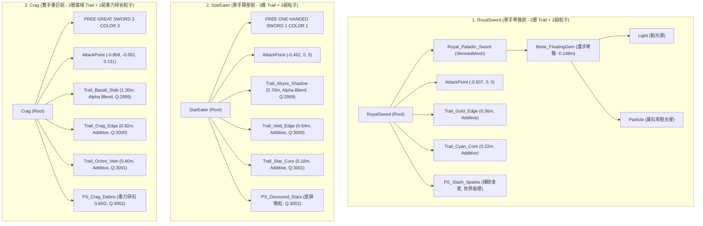

# 大型雙手重武器【泰坦之牙 (TitansTooth)】URP 武器特效規格文檔

---

## 1. 文檔定位與後續交接說明 (Handoff Purpose & Context)

本規格文檔旨在為專案中尚未實作專屬特效之大型雙手重巨刃 **@TitansTooth.prefab**（泰坦之牙）制定完整的 Universal Render Pipeline (URP) 特效規格標準。

專案內目前已有三把完成製作的代表性武器範本：
1. **@RoyalSword.prefab**（皇家英雄劍，標準單手劍，聖光晶體風格）
2. **@StarEater.prefab**（噬星者，敏捷單手劍，深淵虛空倒刺風格）
3. **@Crag.prefab**（岩峰，雙手重巨劍，玄武斷層碎岩風格）

本檔將三大已完成武器的特效階層拓撲、Renderer 材質球設定、GPU 混合模式（Blend Mode）、ParticleSystem 模組參數與貼圖規範進行系統化橫向對比；同時透過 Unity 引擎幾何檢查工具精確測量 **TitansTooth** 的網格體態、刀身向量與局部座標，並依據雙手重武器之戰鬥數值與揮砍力學，制定最合適的放大倍率與特效規格，供後續對話或開發者直接交接製作使用。

> [!NOTE]
> 本任務嚴格執行規格分析與數值設計，**不對工程中的預製體、腳本代碼、材質球或貼圖進行任何生成與修改**。

---

## 2. 已完成三大武器範本技術規格對比 (RoyalSword vs StarEater vs Crag)

### 2.1 武器特性與定位綜覽

| 武器名稱 | 預製體路徑 | 武器類型 (`weaponType`) | 基礎傷害 (`damage`) | 移動速度 (`run/walk`) | 動畫控制器 (`overrideController`) | 視覺與特效主題風格 |
| :--- | :--- | :---: | :---: | :---: | :---: | :--- |
| **RoyalSword** (英雄劍) | `Assets/Prefab/Weapon/RoyalSword.prefab` | 0 (單手劍) | 30 | 7.0 / 3.0 | `OneHandOverride` | 聖光十字、青藍核心能量、金色光刃、懸浮寶石呼吸。 |
| **StarEater** (噬星者) | `Assets/Prefab/Weapon/StarEater.prefab` | 0 (單手劍) | 30 | 7.0 / 3.0 | `OneHandOverride` | 深淵撕裂暗影、虛空幽紫鯊鰭倒刺、星裂電核、吞噬星屑。 |
| **Crag** (岩峰) | `Assets/Prefab/Weapon/Crag.prefab` | 2 (雙手重武器) | 50 | 4.0 / 2.0 | `TwoHandOverride` | 厚重玄武岩層殘影、梯形崩口刀刃、琥珀赭黃礦脈、沉重碎岩拋射。 |

---

### 2.2 特效階層拓撲與掛載架構對比



---

### 2.3 TrailRenderer 軌跡系統詳細參數矩陣

| 參數項目 | RoyalSword (外刃 / 內核) | StarEater (底影 / 外緣 / 核心) | Crag (玄武岩 / 崩口刃 / 礦脈) | 重武器相較於單手劍設計特徵 |
| :--- | :--- | :--- | :--- | :--- |
| **軌跡層數 (Layers)** | 2 層 | 3 層 | 3 層 | 3 層架構（底層剪影 + 中層外緣 + 內層核心）已成專案最佳標準。 |
| **軌跡寬度 (Width)** | 外: `0.36m`, 內: `0.22m` | 底: `0.70m`, 刃: `0.54m`, 核: `0.18m` | **底: `1.30m`, 刃: `0.92m`, 核: `0.40m`** | 重武器寬度大幅放大 **2.56 ~ 3.61 倍**，以匹配刀面厚度。 |
| **滯留時間 (Time)** | `0.12s ~ 0.16s` | `0.32s / 0.26s / 0.16s` | **`0.38s / 0.32s / 0.24s`** | 重武器揮砍角速度慢，滯留時間提升 **1.5 ~ 2.4 倍**。 |
| **寬度曲線 (WidthCurve)** | 頭部 `0.9`，峰值 `1.0 (0.2t)`，尾端平滑縮至 `0.15` | 底層尾部留厚 `0.45`；外緣凸起 `0.75->1.0->0.25`；核心收束 `1.0->0.15` | 底層尾部留厚 `0.55`；崩口刃 `0.85->1.0->0.35`；礦脈 `1.0->0.22` | 重武器底層尾部保持較大厚度（0.35~0.55），營造岩塊/巨風推擠未散感。 |
| **頂點平滑度** | 角頂點: 4, 端點頂點: 2 | 角頂點: 4, 端點頂點: 2 | 角頂點: 4, 端點頂點: 2 | 統一保證大角度揮砍時弧線圓潤不破面。 |
| **最小頂點距離** | `0.015m` | `0.015m` | `0.015m` | 兼顧平滑度與網格頂點開銷。 |
| **對齊方式與貼圖模式** | View (視角對齊) / Stretch (拉伸) | View / Stretch | View / Stretch | Stretch 模式能保證 U 軸完整對齊頭尾過渡。 |

---

### 2.4 ParticleSystem 各模組啟用狀態與參數對比

| 模組 (Module) | RoyalSword (`PS_Slash_Sparks`) | StarEater (`PS_Devoured_Stars`) | Crag (`PS_Crag_Debris`) | 重武器數值演繹方向 |
| :--- | :--- | :--- | :--- | :--- |
| **Main (週期/循環)** | `0.5s` / 循環 / 不喚醒播放 | `0.5s` / 循環 / 不喚醒播放 | `0.5s` / 循環 / 不喚醒播放 | 與揮砍動作幀同步呼叫 `Play()` / `Stop()`。 |
| **生命週期 (Lifetime)** | `0.22 ~ 0.42 s` | `0.22 ~ 0.45 s` | **`0.25 ~ 0.52 s`** | 略微延長上限（1.24x），允許實體碎塊拋射落地。 |
| **初始速度 (Speed)** | `0.15 ~ 0.60 m/s` | `0.05 ~ 0.35 m/s` | **`0.20 ~ 0.95 m/s`** | 提升初速（1.58x），展現巨刃龐大離心力。 |
| **初始尺寸 (Size)** | `0.025 ~ 0.065 m` (星芒) | `0.025 ~ 0.070 m` (星屑) | **`0.045 ~ 0.110 m` (碎石)** | 大幅放大 **1.70 ~ 1.80 倍**，凸顯固態碎片形體。 |
| **重力加速度 (Gravity)** | `0.08` (極輕浮) | `-0.03` (微浮反重力) | **`0.65` (沉重下墜)** | **核心差異**：重武器微粒具實體質量，加速下墜。 |
| **發射器形態 (Shape)** | Box: `(0.05, 0.05, 0.70m)` | Box: `(0.03, 0.03, 0.70m)` | **Box: `(0.10, 0.12, 1.45m)`** | 盒體長度倍增至 1.45m，覆蓋整把長刃發射段。 |
| **距離發射率 (OverDistance)**| 35 顆/m | 45 顆/m | **42 顆/m** | 保持高密度連續揮砍拖尾，避免軌跡破綻。 |
| **單次爆發 (Bursts)** | `8 ~ 14 顆` (0.02s) | `8 ~ 14 顆` (0.02s) | **`12 ~ 18 顆` (0.02s)** | 起刀爆發數提高 1.36 倍，強化力量衝量感。 |
| **阻尼上限 (LimitVelocity)** | `0.05 m/s` (強滯空) | `0.60 m/s` (平滑減速) | **`0.50 m/s` (保留飛濺)** | 允許碎片短暫向外衝出後在空氣中受阻。 |
| **隨機擾動 (Noise)** | `Strength: 0.18, Freq: 1.0` | `Strength: 0.18, Freq: 1.6` | `Strength: 0.14, Freq: 1.4` | 碎石類保持適當亂流，過高會破壞下墜軌跡。 |
| **旋轉翻滾 (Rotation)** | `±0.5 π` rad/s | `±0.5 π` rad/s | **`±1.2 π` rad/s** | 提高翻滾速度 2.4 倍，多面岩石反光更劇烈。 |
| **禁用模組** | Velocity, Inherit, Force, Collision, Trigger, SubEmitters, Lights, Trails | 同左 | 同左 | 堅守效能底線，避免移動裝置或多怪同屏崩潰。 |

---

### 2.5 URP 材質球、GPU Blend Mode 與 Render Queue 規範

所有武器特效材質球均統一基於著色器：
`Universal Render Pipeline/Particles/Unlit` (GUID: `0406db5a14f94604a8c57ccfbc9f3b46`)

```
+-----------------------------------------------------------------------------------------------+
| 层级分层 (Layer)     | 材质代表范例                 | 混合模式 (Blend) | Src/Dst Blend | 渲染队列 (Queue) |
+---------------------+------------------------------+------------------+---------------+----------------+
| Layer 1: 广域暗色底影 | Mat_VFX_Crag_BasaltSlab      | Alpha Blend      | SrcAlpha/OneMinusSrcAlpha (5/10) | 2999 (Offset -1)|
| Layer 2: 锋芒轮廓外刃 | Mat_VFX_Crag_FractureEdge    | Additive         | SrcAlpha/One (5/1)              | 3000 (Offset  0)|
| Layer 3: 能量脉络核心 | Mat_VFX_Crag_OchreVein       | Additive         | SrcAlpha/One (5/1)              | 3001 (Offset +1)|
| Layer 4: 溅射碎屑微粒 | Mat_VFX_Crag_RockChunk       | Additive         | SrcAlpha/One (5/1)              | 3002 (Offset +2)|
+-----------------------------------------------------------------------------------------------+
```

---

### 2.6 貼圖紋理標準與通道設計

所有貼圖均採用自研程序化貼圖生成器（Procedural Texture Generator）產出，嚴格保證像素級銳利度：
* **解析度架構**：
  * 主軌跡外緣（Layer 1 / Layer 2）：`512 x 128` 或 `1024 x 256`（長寬比 4:1）。
  * 核心能量束（Layer 3）：`512 x 64`（長寬比 8:1，高密度中心束）。
  * 碎屑微粒（Layer 4）：`128 x 128` 或 `256 x 256`（1:1 正方形切角多面石塊/晶屑）。
* **UV 映射規範 (LineTextureMode.Stretch)**：
  * $U$ 軸：沿刀身揮砍軌跡長度，$U=0$ 為刀頭（起揮端），$U=1$ 為刀尾（消散端）。
  * $V$ 軸：刀光寬度橫向，$V=0.5$ 為中心脊線，$V=0$ 與 $V=1$ 為雙側羽化邊界。
* **Alpha 透明通道規則**：
  * 頭部瞬態切入：$U=0 \sim 0.03$ 快速平滑升至 1.0。
  * 尾端自然風化/消散：$U > 0.60$ 採指數曲線或 Voronoi 侵蝕噪波破碎收束。

---

## 3. 目標重武器【泰坦之牙 (TitansTooth)】幾何測量報告

透過 Unity MCP 工具檢測場景與資產庫中 `@TitansTooth.prefab` 之實際幾何數據：

### 3.1 網格資產與本地邊界框 (Mesh Bounds)

* **原始 3D 模型資產**：`Assets/Res/Model/ModularItems/Models/Models Original 1.0/FREE GREAT SWORD 1 COLOR 2.fbx`
* **MeshFilter 網格資產**：`FREE GREAT SWORD 1 COLOR 2` (GUID: `735028c5d2bf1c44f8cc16a18d7916e9`)
* **網格模型本地邊界框 (Mesh Local Bounds)**：
  - `Center`: `(0.0114m, 0.0000m, 0.4559m)`
  - `Size`: `(0.4849m, 0.0900m, 2.2983m)`
* **武器實體幾何外形評估**：
  - **武器總長度 (Total Length)**：**2.298 公尺**（約 230 cm）
    *(與 Crag 的 2.294m 相當，為單手劍 RoyalSword 1.337m 的 **1.72 倍**)*
  - **刀身寬度 (Blade Width)**：**0.485 公尺**（48.5 cm）
    *(相較於單手劍 0.150m 為 **3.23 倍**；比 Crag 的 0.668m 窄約 27%，呈現更為修長、如史前巨獸獠牙般銳利內斂之鋸齒刀形)*
  - **刀身厚度 (Blade Thickness)**：**0.090 公尺**（9.0 cm）
    *(比 Crag 的 0.173m 輕薄約 48%，意味著揮砍時風阻較低、刃口切割感更鋒利)*
  - **整劍預製體包圍盒 (Prefab Combined Bounds)**：
    - `Center`: `(-0.375m, -0.054m, 0.052m)`
    - `Size`: `(2.345m, 0.832m, 0.277m)`

---

### 3.2 武器旋轉矩陣與刀身向量分析

在預製體根節點 `TitansTooth` 局部空間下，子物件 `FREE GREAT SWORD 1 COLOR 2` 的變換參數如下：
* **本地座標位移 (LocalPosition)**：`(+0.076, +0.004, +0.015)`
* **本地旋轉四元數 (LocalRotation)**：`(-0.4409, -0.5147, 0.5584, 0.4784)`
* **本地歐拉角 (LocalEulerAngles)**：`(8.799°, 274.726°, 90.725°)`
* **刀身軸向單位向量 (Blade Forward Vector)**：
  $$\vec{V}_{\text{forward}} = (-0.984871, -0.152965, +0.081430)$$
* **刃面法線向上向量 (Blade Up Vector)**：
  $$\vec{V}_{\text{up}} = (-0.080465, -0.012497, -0.996679)$$
* **刀身橫向向右向量 (Blade Right Vector)**：
  $$\vec{V}_{\text{right}} = (-0.153474, +0.988153, +0.000000)$$

---

### 3.3 關鍵特徵點本地座標 (Local Position) 精確記錄

基於上述旋轉矩陣與網格頂點範圍，精確換算 TitansTooth 於武器根節點空間之核心定位點：

| 特徵部位 (Feature Point) | 本地座標 (Local Position) | 距握把原點距離 | 特效配置定位用途說明 |
| :--- | :--- | :---: | :--- |
| **手柄握持原點 (Grip Origin)** | `(+0.076, +0.004, +0.015)` | 0.078 m | 雙手握把中心，角色手部綁定基準點。 |
| **護手核心定位點 (Guard Core)** | `(-0.141, -0.030, +0.033)` | 0.220 m | 獸牙劍格交接處，遠古脊椎骨環核心，能量脈絡發源點。 |
| **碎屑微粒發射中點 (Blade Mid)** | `(-1.050, -0.171, +0.108)` | 1.140 m | 刀身實體中段重心，`PS_Titans_Shards` 發射盒中心。 |
| **打擊判定中心 (AttackPoint)** | `(-0.993, -0.125, +0.103)` | 1.006 m | 戰鬥 Hitbox 判定球中心，配置 `attackRadius = 0.70m`。 |
| **幾何實體刀尖 (Physical Tip)** | `(-1.506, -0.230, +0.146)` | 1.531 m | 獠牙刃尖網格前端最外側頂點（$Z_{\text{mesh}} = 1.605\text{m}$ 處）。 |
| **特效封套刀尖定位點 (VFX Tip)** | `(-1.580, -0.253, +0.152)` | **1.606 m** | 外層刀光尖端掛載點，向外包覆 Hitbox 外緣（1.69m）。 |
| **劍柄末端配重端 (Pommel End)** | `(+0.759, +0.110, -0.041)` | 0.768 m | 劍柄尾端配重骨角尖端（$Z_{\text{mesh}} = -0.693\text{m}$ 處）。 |

---

### 3.4 現有子物件結構與材質槽現況

當前 `TitansTooth.prefab` 內部階層呈現開發過渡期之暫存結構：

```
TitansTooth (Root, Layer: 12 Weapon)
 ├── Rigidbody (Mass: 1, CenterOfMass: [-0.380, -0.098, 0.003])
 ├── BoxCollider (包覆整個武器碰撞)
 ├── DropsInteract (interactableName: "泰坦之牙")
 ├── ShopWeapon (price: 10, weight: 1)
 ├── Sword (damage: 40, weaponType: 2[雙手巨劍], sound: GSword, override: TwoHandOverride, runSpeed: 5, walkSpeed: 3)
 │     ├── attackPoint ──> AttackPoint
 │     ├── weaponTrails ─> [vfx] (舊有單層過渡 Trail)
 │     └── weaponEffect ─> vfx (舊有過渡 ParticleSystem)
 │
 ├── AttackPoint [LocalPos: (-0.993, -0.125, 0.103)]
 ├── vfx [LocalPos: (-1.289, -0.321, 0.130)] (舊有單層 TrailRenderer + 默認粒子，後續需重構替換)
 │     ├── TrailRenderer (使用舊有 Assets/VFX/WeaponEffect/GS_Slash.mat)
 │     └── ParticleSystem (使用舊有 Assets/VFX/SlashParticle/GS.mat)
 └── FREE GREAT SWORD 1 COLOR 2 [LocalPos: (0.076, 0.004, 0.015)]
       ├── MeshFilter: FREE GREAT SWORD 1 COLOR 2 (GUID: 735028c5d2bf1c44f8cc16a18d7916e9)
       └── MeshRenderer:
             └── [Material Slot 0]: Base Palette Material URP.mat (GUID: 9845b38987b69224ca6524623f877af8)
```

---

## 4. 【泰坦之牙】專屬重武器特效放大倍率與規格建議

### 4.1 武器風格與手感定位

* **設計關鍵詞**：**遠古泰坦巨獸之牙、象牙骨質、野性撕裂、原始琥珀裂紋、骨刺飛濺**。
* **手感差異化**：
  * 與 **Crag（岩峰）** 相比：Crag 傷害 50、跑速 4，特效為大塊玄武岩重砸（重力 0.65）；TitansTooth 傷害 40、跑速 5、厚度減半，屬於「具備巨劍破壞力但揮動更凌厲凶狠的巨獸撕咬刃」。
  * 與 **RoyalSword（英雄劍）** 相比：長度放大 1.72 倍、寬度放大 3.23 倍，特效絕不可沿用單手劍數值。

---

### 4.2 建議之 3 層 Trail 軌跡系統規格 (Trail Specification)

建議後續替換掉舊有的單層 `vfx` 物件，採用標準 3 層獨立節點架構：

```
[RoyalSword 0.36m]     █████████
[Titans Core 0.32m]    ████████ (1.45x vs RoyalCore 0.22m)
[Titans Edge 0.80m]    ████████████████████ (2.22x vs RoyalEdge 0.36m)
[Titans Breath 1.15m]  █████████████████████████████ (3.19x vs RoyalEdge 0.36m)
```

1. **Layer 1：巨獸狂怒氣流底層 (`Trail_Titans_Aura`)**
   - **渲染模式**：Transparent / **Alpha Blend** (Render Queue: **2999**, QueueOffset: -1)
   - **建議寬度**：**1.15 公尺**（相較於 RoyalSword 外刃放大 **3.19 倍**，比 Crag 的 1.30m 略收束）
   - **掛載本地座標**：`(-1.180, -0.190, +0.118)`（位於刀身 1.25m 處）
   - **滯留時間**：**0.34 秒**（相較於 RoyalSword 放大 **2.13 倍**）
   - **寬度曲線**：`Key(0s, 0.90) -> Key(0.22s, 1.00) -> Key(1s, 0.40)`
   - **色彩與視覺**：暗土黃漸變至風化象牙褐，邊緣帶有巨獸撕咬的粗糙羽化，呈現大範圍風阻破空體積。

2. **Layer 2：獠牙鋸齒主刃緣 (`Trail_Titans_Edge`)**
   - **渲染模式**：Transparent / **Additive** (Render Queue: **3000**, QueueOffset: 0)
   - **建議寬度**：**0.80 公尺**（相較於 RoyalSword 外刃放大 **2.22 倍**，精準貼合 0.485m 牙刃寬度並外擴）
   - **掛載本地座標**：`(-1.580, -0.253, +0.152)`（位於封套刀尖 1.68m 處）
   - **滯留時間**：**0.28 秒**（相較於 RoyalSword 放大 **1.75 倍**）
   - **寬度曲線**：`Key(0s, 0.80) -> Key(0.20s, 1.00) -> Key(1s, 0.25)`
   - **色彩與視覺**：明亮象牙白（HDR 2.0）漸變至狂暴金黃，外緣展現如暴龍巨齒般的非對稱倒刺剪影。

3. **Layer 3：遠古脊髓裂核 (`Trail_Titans_Spine`)**
   - **渲染模式**：Transparent / **Additive** (Render Queue: **3001**, QueueOffset: 1)
   - **建議寬度**：**0.32 公尺**（相較於 RoyalSword 核心 0.22m 放大 **1.45 倍**）
   - **掛載本地座標**：`(-1.380, -0.222, +0.136)`（位於刀身能量中脊 1.45m 處）
   - **滯留時間**：**0.20 秒**（相較於 RoyalSword 放大 **1.25 倍**）
   - **寬度曲線**：`Key(0s, 1.00) -> Key(1s, 0.18)`
   - **色彩與視覺**：極高亮原始琥珀金核（HDR 2.5），如脊椎神經脈絡般緊貼刀身內側。

---

### 4.3 泰坦骨刺與碎屑粒子系統規格 (`PS_Titans_Shards`)

> 建議將原有的舊版 `vfx` ParticleSystem 升級重構為掛載於 `(-1.050, -0.171, +0.108)` 的專屬粒子發射器：

| 參數項目 (Parameter) | RoyalSword 基準值 | TitansTooth 重武器建議值 | 建議放大倍率 | 設計理由與力學分析 |
| :--- | :---: | :---: | :---: | :--- |
| **發射器範圍 (Shape Box)** | `(0.05, 0.05, 0.70m)` | `(0.08, 0.08, 1.45m)` | **長度 2.07 倍** | 完美覆蓋 TitansTooth 實體刃部長度（0.45m ~ 1.90m 範圍）。 |
| **位移發射率 (OverDistance)**| 35 顆/m | **40 顆/m** | **1.14 倍** | 重刃揮舞路徑長，保持每米 40 顆骨屑分佈，視覺密度均勻不空洞。 |
| **揮刀起手爆發 (Burst)** | 8 ~ 14 顆 | **10 ~ 16 顆** | **1.20 倍** | 起刀瞬間迸發骨刺碎屑，展現巨力甩刀之反作用力。 |
| **微粒初始尺寸 (Size)** | `0.025 ~ 0.065 m` | **`0.040 ~ 0.095 m`** | **1.50 ~ 1.60 倍** | 呈現如碎骨、銳利獸牙切面般的菱形立體碎塊（4~9.5cm）。 |
| **初始速度 (Speed)** | `0.15 ~ 0.60 m/s` | **`0.20 ~ 0.85 m/s`** | **1.40 倍** | 離心拋射動能強大，骨屑向外甩出距離更遠。 |
| **微粒生命週期 (Lifetime)** | `0.22 ~ 0.42 s` | **`0.25 ~ 0.48 s`** | **1.14 倍** | 提供適度滯空並在消散前展現重力下墜軌跡。 |
| **重力加速度 (Gravity)** | 0.08 (幾無重力) | **0.45 (中重度骨石)** | **5.63 倍** | 骨質碎片比金屬火花（0.08）重得多，但略輕於玄武岩塊（0.65），具拋物線下墜感。 |
| **阻尼速度上限 (Limit)** | 0.05 m/s | **0.40 m/s** | **8.00 倍** | 允許骨屑在空氣中保有一定水平衝量，而非定格懸浮。 |
| **翻滾角速度 (Rotation)** | `±0.50 π` rad/s | **`±1.00 π` rad/s** | **2.00 倍** | 尖銳骨刺在空中高速翻轉，高光反射更加凌厲。 |
| **色彩漸變 (ColorOverLifetime)**| 聖光白金漸隱 | 象牙白 -> 琥珀金 -> 骨灰淡出 | - | 起始高亮，隨後過渡至古老風化之暗淡骨色。 |

---

### 4.4 專屬貼圖規劃建議 (Texture Assets Specification)

後續若要為 TitansTooth 生產貼圖，建議規劃如下 4 張專屬貼圖（存於 `Assets/VFX/TitansTooth/`）：
1. `Tex_Titans_Aura_Torn.png`（`512x128`，RGBA32）：獸骨狂氣與風壓撕裂紋理，用於 Layer 1 底層陰影。
2. `Tex_Titans_Serrated_Edge.png`（`512x128`，RGBA32）：具備非對稱粗獷巨獸獠牙倒刺（6~8 組梯尖交錯），用於 Layer 2 主刀刃。
3. `Tex_Titans_Spine_Crack.png`（`512x64`，RGBA32）：中心高熱神經脈絡電裂光條，用於 Layer 3 核心。
4. `Tex_Titans_BoneShard.png`（`128x128`，RGBA32）：尖銳多邊形象牙骨片碎屑，用於 Layer 4 粒子。

---

## 5. 全武器橫向交接速查總綱 (Master Universal Handoff Matrix)

本表格整合工程內全部 4 把武器之實體規格，供後續開發與跨對話無縫交接使用：

```
+========================================================================================================================+
|                                    DUNGEON WEAPON VFX MASTER SPECIFICATION MATRIX                                     |
+===========================+======================+======================+======================+=======================+
| 規格項目 \ 武器名稱       | 1. RoyalSword (英雄劍)| 2. StarEater (噬星者)| 3. Crag (岩峰)       | 4. TitansTooth (泰坦) |
+===========================+======================+======================+======================+=======================+
| 武器分類 (WeaponType)     | 0 (單手劍 - 聖光)    | 0 (單手劍 - 虛空)    | 2 (雙手重劍 - 玄武岩)| 2 (雙手重劍 - 泰坦牙) |
| 武器總長度 (Total Length) | 1.337 m              | 1.142 m              | 2.294 m              | 2.298 m (2.30m)       |
| 刀身實體寬度 (Blade Width)| 0.150 m              | 0.120 m (格:0.41m)   | 0.380 m (凸:0.67m)   | 0.485 m               |
| 刀身厚度 (Thickness)      | 0.121 m              | 0.146 m              | 0.173 m              | 0.090 m               |
| 刀身朝向向量 (Forward)    | (-1, 0, 0)           | (-1, 0, 0)           | (-0.980, -0.156, 0.125)| (-0.985, -0.153, 0.081)|
| 刀尖定位點 (Tip Pos)      | (-1.085, 0, 0)       | (-0.900, 0, 0)       | (-1.666, -0.266, 0.212)| (-1.580, -0.253, 0.152)|
| 護手核心點 (Guard Pos)    | (-0.148, 0, 0)       | (0, 0, 0)            | (-0.183, -0.032, 0.025)| (-0.141, -0.030, 0.033)|
| 打擊判定點 (AttackPoint)  | (-0.507, 0, 0) R:0.7m| (-0.462, 0, 0) R:0.55| (-0.858, -0.09, 0.13) | (-0.993, -0.13, 0.10) |
+---------------------------+----------------------+----------------------+----------------------+-----------------------+
| 刀光層數 (Trail Layers)   | 2 層                 | 3 層                 | 3 層                 | 3 層 (建議規劃)       |
| Layer 1: 底影寬度 / 滯留  | -                    | 0.70m / 0.32s (Q2999)| 1.30m / 0.38s (Q2999)| 1.15m / 0.34s (Q2999) |
| Layer 2: 外刃寬度 / 滯留  | 0.36m / 0.12s (Q3000)| 0.54m / 0.26s (Q3000)| 0.92m / 0.32s (Q3000)| 0.80m / 0.28s (Q3000) |
| Layer 3: 核心寬度 / 滯留  | 0.22m / 0.16s (Q3000)| 0.18m / 0.16s (Q3001)| 0.40m / 0.24s (Q3001)| 0.32m / 0.20s (Q3001) |
+---------------------------+----------------------+----------------------+----------------------+-----------------------+
| 粒子尺寸 (Particle Size)  | 0.025 ~ 0.065 m      | 0.025 ~ 0.070 m      | 0.045 ~ 0.110 m      | 0.040 ~ 0.095 m       |
| 粒子發射長度 (Shape Box)  | 0.70 m               | 0.70 m               | 1.45 m               | 1.45 m                |
| 粒子移動發射率 (OverDist) | 35 顆/m              | 45 顆/m              | 42 顆/m              | 40 顆/m               |
| 起刀爆發數 (Burst Count)  | 8 ~ 14 顆            | 8 ~ 14 顆            | 12 ~ 18 顆           | 10 ~ 16 顆            |
| 重力加權 (Gravity Modifier)| 0.08 (漂浮火花)      | -0.03 (反重力浮星)   | 0.65 (沉重巨石碎塊)  | 0.45 (史前象牙骨屑)   |
| 粒子生命週期 (Lifetime)   | 0.22 ~ 0.42 s        | 0.22 ~ 0.45 s        | 0.25 ~ 0.52 s        | 0.25 ~ 0.48 s         |
+===========================+======================+======================+======================+=======================+
```

---
*文檔更新完成時間：2026-11-08*  
*適用管線：Universal Render Pipeline (URP)*  
*存檔路徑：`VFX_Spec_TitansTooth.md`*
